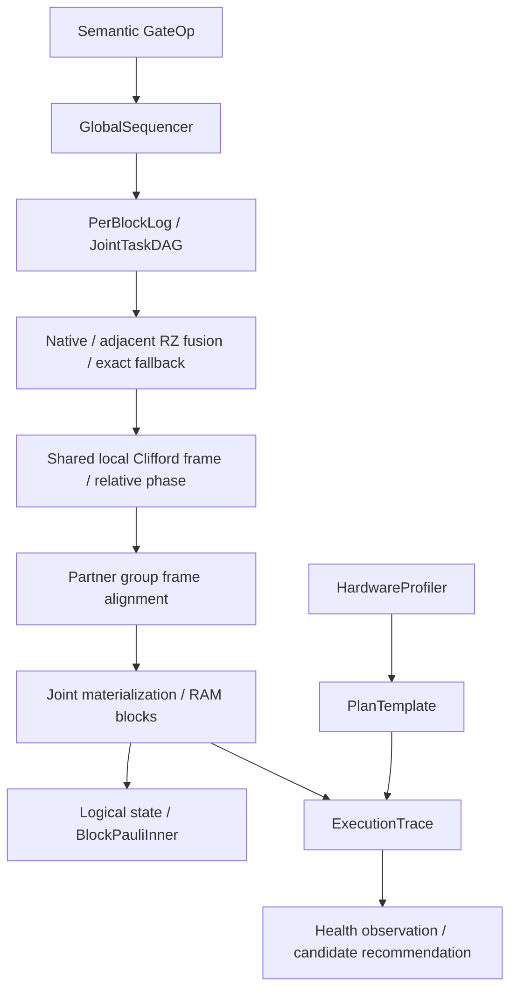

# Phase 0 設計書

## 1. 目的と実装範囲

[開発計画 Phase 0](../plan/distributed_quantum_circuit_simulator_development.md#phase-0意味保存gate-irnative-first分岐layout参照テスト) に対応する、単一プロセス・RAM 上の数値検証実装である。Python 3.12 以上、uv、NumPy、pytest を使用する。パッケージ名は `svsim`、Python プロジェクト名は `ddq`。

入力の意味を保存する Gate IR から、Global Sequencer、Per-Block Log、局所 Clifford Frame、Joint DAG を経由して状態を具体化する。任意 U(2)/U(4)、symbolic 回転、MCX、論理 SWAP と物理レイアウト遷移、期待値・随伴勾配を検証する。HardwareProfile → PlanTemplate → ExecutionTrace と性能監視の型も初期構成に含める。

追加要件として、Linux `O_DIRECT` と macOS `F_NOCACHE` の同期ストレージ抽象化を用意した。この API は独立して検証できる。シミュレータの Block 保存先は現在 RAM であり、ファイルへの自動退避とはまだ接続していない。

## 2. コンポーネントと責務

| ファイル | コンポーネント・責務 |
|---|---|
| `src/svsim/ir.py` | GateOp、GateNormalizer、GlobalSequencer、NativeGateSelector、FallbackDecomposer |
| `src/svsim/parameters.py` | ParameterSymbol、型付き Expr DAG、immutable ParameterBinding、式評価・微分 |
| `src/svsim/unitary.py` | UnitaryValidator、immutable MatrixAssetRegistry |
| `src/svsim/runtime.py` | DeferredSimulator、圧縮 PerBlockLog、JointTaskDAG、BlockView/Version、共有 FrameGroupRegistry |
| `src/svsim/kernels.py` | 小行列適用、predicate MCX、独立した scalar eager reference |
| `src/svsim/layout.py` | QubitLayout、物理 index-bit 交換、論理順への出力変換 |
| `src/svsim/observables.py` | PauliTerm、ObservableIR、StateHandle、BlockPauliInner、GradientPlanTemplate、随伴参照計算 |
| `src/svsim/lifecycle.py` | HardwareProfiler、StaticCircuitOptimizer、AdaptiveRuntimeScheduler、profile/plan/trace/health/candidate 型 |
| `src/svsim/transport.py` | StorageFile、StorageCapabilities、OS ごとの positional I/O |



## 3. 状態表現と不変条件

### 3.1 振幅と bit 順序

`n` 量子ビットの配列は長さ `2**n` の complex128。qubit 0 を添字の最下位 bit とする。`block_bits=b` の Block は物理配列の連続した `2**b` 要素であり、上位 bit を Block ID とする。

Block は独立した量子部分系ではない。各 Block の振幅は未正規化のまま保持し、Block ごとの正規化を行わない。初期状態は既定で |0...0>、指定時は有限値・長さを検証する。

各 Block の論理振幅は `relative_phase * CliffordFrame(base_amplitudes)`。位相は複素数で保持する。異なる Block の Frame と位相を解消してから非局所振幅を混合するため、相対位相を失わない。

### 3.2 正本、ログ、frontier

- `GateOp` は immutable。GlobalSequencer が一意で連続した `op_id` を割り当てる。登録時は振幅を更新しない。
- 各 Block の論理ログは、物理的には演算ごとの共有レコードと upper-control predicate から構成する。`view(block_id, frontier)` は条件に合う履歴を返す。レコードは登録時の `layout_id` を持つ。
- Cross-Block の非対角ゲートは一意な JointTask を持つ。初期 DAG は直前演算を predecessor とする保守的な鎖である。入力 frontier と出力 frontier を区別する。
- `materialize(blocks=None, frontier=None, binding=None)` は指定 frontier まで論理順に適用する。部分 Block 指定も依存を安全に閉じるため全 Block の cut を進める。非同期・部分 materialization は将来拡張。
- 同じ frontier の再 materialization は二重適用しない。過去 frontier への巻き戻しは拒否する。
- `BlockView` は物理 base version、論理 frontier、frame_id、相対位相を分ける。版には binding_id、layout_id、影響する parameter ID 集合を保持する。依存集合は現在、全 Block に対する保守的な集合。

### 3.3 局所 Frame と具体化

FrameGroupRegistry は immutable な局所 Clifford 列を共有する。現在は tableau の代わりに gate sequence を使う参照実装である。同じ列を hash-cons し、条件付き更新時は別の列を作る。既存の共有 Frame を変更しない。

下位 H/S/X/Z/CX/CZ/SWAP 等は局所 Frame に吸収する。上位制御は Block predicate として評価し、残った局所作用が Clifford の場合のみ吸収する。多制御 MCX を全体系の Clifford として扱わない。

局所 Non-Clifford 前にはその Block の Frame と位相を具体化する。上位 1Q 対角作用は Block 別相対位相へ蓄積する。上位 target が振幅を混合する場合は、target の上位 bit が定める partner group を確保し、全入力 Frame・位相を identity へ具体化してから同時に出力を計算する。

Frame の非 Clifford 共役最適化は行わず、この具体化により順序を保存する。全状態に対する巨大な unitary を生成しない。

## 4. Gate IR、native、fusion、fallback

### 4.1 正規化

入力ゲートは H/S/SDG/Z/T/TDG/RX/RY/RZ/CZ/SWAP/MCX/DENSE_UNITARY。X、CX/CNOT、CCX/Toffoli、CCCX は MCX に統合する。control_values は任意の 0/1 条件を表す。対象・制御の重複、範囲、arity、parameter/matrix の不適切な指定を拒否する。

IR は対角・置換・Clifford の意味属性、対象、制御、symbolic angle、matrix asset ref、近似誤差を保持する。Dense asset の対角・置換属性は完全一致のみで判定し、数値的に近い行列を別の演算へ変更しない。

### 4.2 実行経路

既定は `execution='auto'`。NativeGateSelector は現在の QubitLayout から候補を示し、runtime が Frame、局所 native、位相、Joint 経路を確定する。trace に候補と実際の path を記録する。

隣接する同じ対象・制御条件の RZ は symbolic angle の和へ融合する。非可換ゲートの順序は変更しない。source_ops は融合前の全 op_id を保持する。

MCX は control_mask/control_value/target_bit を用いて条件に一致する振幅対を交換する。制御数に対応する dense 行列は作らない。upper-target の場合も partner group 内で局所 offset の predicate を評価する。

`execution='fallback'` は初期 named gate set を H/S/T/CNOT（IR 上は 1-control MCX）/RZ へ正確に分解する比較モード。RX、RY、CZ、SWAP、negative-control CX 等に対応する。分解の `source_op_id` と `approximation_error` を保存し、元ゲートと分解列を同時実行しない。

任意 Dense U、2 個以上の制御を持つ MCX、一般 Controlled-U の universal synthesis は未実装。強制 fallback はその演算を具体化前に拒否する。既定 native はこれらを維持する。Clifford+T 近似合成は行わない。

## 5. 任意 unitary と symbolic parameter

### 5.1 MatrixAsset

shape は `(2**k, 2**k)`。有限値、メモリ制限、unitarity の Frobenius residual を検証する。既定 tolerance は `1e-12`、最大 4 target、最大 1 MiB。利用者の行列を補正しない。

immutable bytes に `<c16`、C order で保存し、shape・dtype・bit 順序・内容から asset hash を作る。入力配列を変更しても asset は変化しない。同一内容は共有する。matrix index の LSB は `targets[0]`。固定 U(2)/U(4) が必須検証範囲であり、3Q/4Q は参照 kernel のみ、性能最適化は今後の範囲。

### 5.2 Parameter DAG と Binding

ParameterSymbol は名前と独立した ID を持ち、同名でも別記号を区別する。Expr は const/symbol/add/mul/div/neg/sin/cos の immutable ノードで構成する。加減乗除の operator と式の微分を用意する。任意 Python コード評価を行わない。

ParameterBinding は circuit_hash と ID ごとの有限値をソートした immutable tuple。binding_id はその canonical 内容の hash。未束縛、範囲違反、非有限値を具体化前に検証する。

別 binding の実行には新しい Simulator を使用する。実行済み状態に別 binding を上書きしない。実行済み prefix にゲートを追加する場合は circuit_hash を更新して既存束縛を引き継ぎ、次回 materialization で追加式を検証する。

値依存の Clifford 化、identity 除去、prefix snapshot 再利用は行っていない。したがって「ほぼ Clifford」を無条件に Frame へ吸収したり、RZ(2*pi) の条件付き相対位相を捨てたりしない。

## 6. 論理 SWAP と物理レイアウト

論理 `SWAP(a,b)` は回路の演算であり、論理状態を変更する。QubitLayout は logical-to-physical の bijection と版を持つ。

`physical_index_bit_swap(a,b)` は物理 bit 位置を交換する。先に current cut を具体化し、振幅配列を転置し、QubitLayout を同時更新する。`state()` はレイアウトを使って論理順へ変換するため、この操作の前後で論理状態は不変。新しいレイアウトで後続のゲートも実行できる。

この初期実装は転置時に全状態を RAM に集める。ストリーミング物理転置、FusedSWAP、MPI layout planner は Phase 1 以降で実装する。

## 7. 期待値と随伴勾配

PauliTerm は logical x_mask/z_mask と係数を保持する。Y は X/Z 両 mask を立て、`i**popcount(x&z)` と Z parity の位相を適用する。`from_string()` は左から qubit 0,1,... の順で、一般的な MSB-first 表記との違いを明示する。

BlockPauliInner は upper X mask による Block partner と lower X mask による offset partner の内積を取る。全状態行列や全状態 gather を内積の中で作らない。異なる Frame・相対位相は StateHandle capture 時に解消する。異なる layout/Block 幅の handle は拒否する。ObservableIR は実係数 Pauli 和による Hermitian observable。

StateHandle は immutable Block 配列、layout、frontier、binding_id、forward/adjoint role を持つ。現在の runtime cut を `from_simulator()` で捕捉できる。

adjoint_gradient は小規模 NumPy の store-all 参照計算。Forward state 列を保存し、observable を作用した adjoint state を逆向きに更新する。回転の generator と Expr の chain rule を使い、勾配の inner product は BlockPauliInner の identity Pauli 経路へ集約する。制御条件を満たさない branch の微分は 0。

GradientPlanTemplate は回路・observable・parameter IDs・方法・版・checkpoint 方針の型を定義する。I/O-aware method 選択、分散 reduction、checkpoint/recompute は未実装。

## 8. profile → plan → trace と性能監視

HardwareProfiler は CPU、RAM、指定パスの disk 容量/空き、NIC interface 名を read-only で検出する。Linux は `/proc`、macOS の RAM は `sysctl hw.memsize` も利用する。取得できない性能・容量情報は None とし、帯域を創作しない。

HardwareProfile と PlanTemplate は profile/plan ID と版を持つ。StaticCircuitOptimizer は回路 hash、layout、保守的な dependency chain、frontier、候補を plan schema にする初期 stub。DeferredSimulator はこの profile/plan に対応する ExecutionTrace を記録する。

ExecutionTrace は schema_version、trace version、profile_id、plan_id、plan_version と task event を持つ。runtime は実行 path、時間、source op、binding、layout、誤差を記録する。現在は compute 時間であり、SSD/MPI 帯域の実測 trace ではない。

BenchmarkCondition は block size、I/O depth、read fraction、MPI 同時利用、rank 数などの負荷条件。BenchmarkSample は帯域/latency、標本数、信頼区間を保持する。AdaptiveRuntimeScheduler は同じ条件の基準と比較し、DEGRADED/HEALTHY/不足状態を返す。

RuntimeProfile、HealthReport、PlanCandidate、observe/recommend/auto、LIVE_TUNE/FRONTIER_REPLAN/RESTART_REQUIRED を型として区別する。監視は現在、検出と候補提示まで。auto でも候補を実際に適用しない。persistency/hysteresis、ETA 校正、安全な commit は今後の実装範囲。

## 9. Linux/macOS ストレージ抽象化

[追加された I/O 資料](../ref/direct_io_linux_macos.md) に従い、共通 API を OS の機能から切り離す。

```python
from svsim import open_storage

with open_storage('state.bin', 'w+b', backend='direct') as storage:
    storage.write(0, b'\0' * 4096)
    storage.flush()
    block = storage.read(0, 4096)
    print(storage.capabilities)
```

| 選択・OS | 実装 | 制約・意味 |
|---|---|---|
| `buffered` | pread/pwrite | 通常のキャッシュ経路。offset と length は非負整数 |
| `direct` / Linux | O_DIRECT + mmap の整列 buffer + preadv/pwritev | buffer address、offset、length を指定 alignment に整列。既定 4096 bytes |
| `direct` / macOS | open + fcntl(F_NOCACHE,1) + pread/pwrite | キャッシュ抑制。Linux と同じ整列制約を課さない |

`StorageCapabilities` は backend identity、direct_io、cache_avoidance、alignment を公開する。macOS は `direct_io=False` で、O_DIRECT と完全等価な意味を主張しない。

read は EOF 時に短い bytes を返す。write は完了までループする。Linux の partial write が整列を壊した場合はエラーを返す。Linux の要件は filesystem 依存で、4096 は保守的な既定値。statx 自動検出は未実装。呼び出し側が対象に合わせて alignment を設定する。

モードは rb/r+b/wb/w+b。positional write を保証するため append mode を拒否する。明示された backend が使えない場合に buffered へ黙って fallback しない。macOS の fcntl 失敗時も descriptor を閉じて例外を返す。

`flush()` は fsync、context manager は descriptor を閉じる。F_NOCACHE/O_DIRECT 自体は永続化を保証しない。F_FULLFSYNC、F_RDAHEAD、io_uring、非同期 I/O、application Block Cache は未実装。

## 10. 検証と開発コマンド

```sh
uv sync
uv run pytest
uv run python examples/phase0.py
```

- 8/10/12 量子ビットで、ランダム初期状態、固定任意 U、symbolic RZ fusion、異なる Frame・相対位相・上位 H/CX を独立 eager reference と比較。
- MCX は制御数 0..6、open control、local/upper target/upper control/partial exchange を比較し、自己逆性も検証。
- named gate の exact fallback と source/error 保存を比較。
- Binding 不一致や未束縛時に状態更新前に拒否し、frontier の再適用で演算が重複しないことを検証。
- 物理 bit swap による論理状態不変と、layout 変更後の後続回路を検証。
- Pauli block 内積を独立 tensor oracle、随伴勾配を有限差分と比較。
- profile の discovery、同じ負荷条件のみの health 比較、mode/category/trace の境界を検証。
- macOS の実 F_NOCACHE、Linux の模擬 O_DIRECT flag/整列/partial transfer、失敗時 cleanup を検証。Linux 実 O_DIRECT test は Linux で実行する。

## 11. 決定事項と次段階

Phase 0 は正確性の参照実装を優先し、RAM 使用量・metadata の性能上限をまだ強制しない。ゲートログは共有レコードだが、状態の Block 辞書、Frame membership、版管理は小規模用。40/50 qubit の metadata 評価や速度改善は本実装の検証結果から主張しない。

次段階では、同期 transport を Block storage に接続し、RAM budget/cache、COW checkpoint、実際の read/write trace と benchmark、tableau の Frame、効率的な Block membership と索引を実装する。既存の semantic GateOp、immutable Binding、layout、profile/plan/trace の責務を維持して拡張する。
