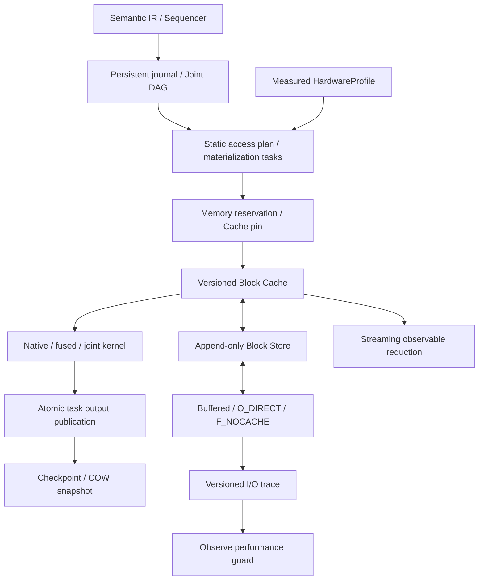

# Phase 1 設計書：単一ノード RAM＋SSD/HDD

- 作成日：2026-10-12
- 状態：Phase 1 の初期実装を追加済み。本書は設計仕様で、実装した API・具体化した選択・制約・検証は [実装と検証](phase1_implementation.md) を参照する。
- 対応仕様：[開発計画 §18 Phase 1](../plan/distributed_quantum_circuit_simulator_development.md#phase-1単一ノードramssdhdd)
- 前提：[Phase 0 設計書](phase0_design.md)、[Linux/macOS I/O 資料](../ref/direct_io_linux_macos.md)
- 開発環境：Python 3.12 以上、uv、NumPy、pytest。新規依存は原則追加しない。

## 1. 到達目標

状態全体が RAM に収まらなくても、単一プロセスでゲート適用と期待値計算を完了できるようにする。Phase 0 の semantic Gate IR、immutable Binding、Block-local Frame、Joint DAG、QubitLayout、profile→plan→trace の責務を維持する。

Phase 1 の完了は、状態・観測量の参照一致、管理対象 RAM 上限の遵守、実測 I/O の説明、snapshot の分岐と再開の正確性で判定する。高速化は測定結果で示し、すべての回路に対して期待しない。

| 計画の要件 | Phase 1 の成果物 |
|---|---|
| Block Cache、COW、同期 I/O | version-keyed Cache、append-only Block Store、整合した snapshot |
| Linux/macOS 開発 | buffered / Linux O_DIRECT / macOS F_NOCACHE 共通 API |
| 物理 index-bit SWAP | Block 内・上位間・下位/上位の容量制限付き転置と layout barrier |
| Local/Shared/Joint Log | 永続 journal、共有 predicate、安定した ID、replay |
| native と fusion | 専用 1Q/対角/CX/CZ/MCX、1Q/2Q Dense、小規模 fusion |
| 任意 3Q/4Q の比較 | native と exact structured decomposition の比較 |
| パラメータ反復 | 非依存 prefix snapshot と Binding ごとの COW suffix |
| profile→plan→trace | 単体 RAM/I/O 測定、静的アクセス予測、実測 trace |
| 性能低下 | MockTransport、同一負荷比較、observe での継続検出 |
| SSD streaming observable | partner-group 単位の ObservablePlan、gather なしの reduction |

MPI、非同期 I/O、io_uring、lookahead/FusedSWAP、tableau Frame、Frame の非 Clifford 共役最適化、I/O-aware 勾配スケジューラ、自動再計画 commit は後続 Phase に置く。Frame は Phase 0 の共有 gate sequence を継続使用する。

## 2. 現状からの変更

現在の `DeferredSimulator` は全初期状態、Block 辞書、各 Block の metadata を RAM に保持する。`state()`、物理 SWAP、`StateHandle.from_simulator()` は全状態を結合し、kernel は大きな添字配列とコピーを生成する。`materialize()` の最後にはすべての Frame を具体化する。

この経路を外部記憶 runtime に流用すると、Cache に上限を設けても RAM 上限を満たせない。Phase 0 runtime は小規模 oracle として残し、新しい `StoredSimulator` を追加する。semantic 型と小行列生成、Frame sequence、参照テストを共有する。

`StateHandle` の immutable な RAM 配列型も参照用として残す。新しい `StoredStateHandle` は snapshot/version catalog を参照し、振幅を所有しない。Block 内積の算術を共通化し、読み出し方式を分離する。

## 3. コンポーネント

| 追加・変更先 | 主責務 |
|---|---|
| `storage.py` | StorageConfig、BlockRef、FileBlockStore、版付き segment、catalog |
| `cache.py` | MemoryBudget、BlockCache、BufferLease、pin/reserve/evict |
| `journal.py` | Gate/Local/Shared/Joint/TaskCommit/layout event、schema と replay |
| `stored_runtime.py` | StoredSimulator、依存を閉じる materialization、実行モード |
| `checkpoint.py` | SnapshotManifest、consistent cut、COW root、再開・prefix fork |
| `planner.py` | AccessPlan、MaterializationTask、kernel working-set、静的 byte 予測 |
| `streaming_kernels.py` | 予約 buffer に対する専用 native/fused/joint kernel |
| `observable_plan.py` | StoredStateHandle、ObservablePlan、Block pair reduction |
| `benchmark.py` | RAM/storage 単体測定、比較実験、レポート |
| `transport.py` | 既存 API を保持し、予約済み buffer 向け read_into/write_from を追加 |
| `lifecycle.py` | I/O event の負荷条件、窓ごとの observe 評価、trace の逐次出力 |



## 4. 型と版の不変条件

### 4.1 永続 ID

Phase 0 の `repr()` ベース circuit hash を永続 format にしない。Gate IR、Expr DAG、asset ID、qubit 数、bit 順序を schema-versioned canonical JSON で記録し、内容 hash を計算する。symbol ID は保存・再読込で維持し、名前から再生成しない。複素数は実部/虚部、float は round-trip 可能な形式、matrix は既存 `<c16` asset の内容 hash を使用する。

| 型 | 必須の内容 |
|---|---|
| `StorageConfig` | directory、block_bits、ram_budget_bytes、backend、alignment、segment size |
| `BlockRef` | state/run ID、logical Block ID、immutable version ID、segment/offset、payload/storage bytes、checksum |
| `StoredBlockView` | BlockRef、physical base frontier、logical frontier、layout_id、frame_id、phase、parameter dependencies |
| `MaterializationTask` | task/source op IDs、入力版、対象 rule、出力 frontier、binding_id、layout_id、working-set bytes |
| `StoredStateHandle` | immutable snapshot root、cut、circuit hash、binding fingerprint、layout、role |
| `SnapshotManifest` | schema/generation、catalog root、journal cursors、Frame/asset refs、layout、cut、binding/dependencies |

Cache key は `(state_id, block_id, version_id)`。旧版、snapshot、異なる Binding の Block が同じ entry を指して書き換えられないようにする。logical frontier を進めても、振幅未更新なら physical base frontier は進めない。

### 4.2 不変条件

1. Block は未正規化の振幅区間であり、相対位相を保存する。
2. Frame は下位 bit の Clifford のみ。Non-Clifford は順序付き log に保持する。
3. GateOp が正本。lowering task は source op へ一意に対応し、両方を実行しない。
4. Joint Task は入力版集合を検証し、全出力を一度に公開する。片方だけの frontier を後続へ見せない。
5. Cache eviction は物理搬送であり、ゲートや Frame の適用ではない。
6. Frame/phase、base frontier、log cursor の組合せを保存し、replay で二重適用しない。
7. layout barrier の前後で異なる layout の Block を混在させない。
8. snapshot の extent は immutable。書き込みは新しい COW 版へ行う。

## 5. Block Store と OS 別 I/O

### 5.1 ファイル構成

```text
run/
  state/segment-000000.bin       # 複数 Block の immutable base/COW 版
  metadata/catalog.sqlite3      # Block 版、root、索引、snapshot commit 状態
  journal/gates.jsonl            # semantic IR と Expr/asset 参照
  journal/local.jsonl
  journal/shared.jsonl
  journal/joint.jsonl
  journal/commits.jsonl          # task / layout commit、入力版と出力版
  assets/<content-hash>.bin
  frame/registry.jsonl
  manifests/snapshot-<id>.json   # catalog の committed manifest の export
  traces/execution.jsonl
```

Block ごとのファイルは作らない。振幅は alignment 単位の固定 slot に保存し、payload は `16 * 2**block_bits` bytes。slot は payload を alignment の倍数へ切り上げる。padding は 0、checksum は payload に対して計算し、trace では payload bytes と実際の transfer bytes を区別する。

小さな Block でも Linux direct で読み書き可能にするため、slot の padding を許す。初期実装は部分 MCX でも完全 slot を転送し、predicate が選ぶ振幅数と実転送 byte 数を別記録する。

catalog は標準ライブラリ SQLite による disk index。Block 全件を Python dict に展開しない。root は親 root と sparse override の関係で表し、snapshot fork で全振幅・全 index を複製しない。snapshot に採用した root は seal して immutable にし、その後の更新は子の working root へ書く。root chain の深さに上限を設定し、必要時は disk 上で逐次 flatten する。SQLite page cache と query 結果の最大件数も制限する。

### 5.2 transport の契約

既存 `open_storage(..., backend='buffered'|'direct')` を継続利用する。Linux は O_DIRECT、macOS は F_NOCACHE を選択し、失敗時に buffered へ黙って切り替えない。journal/catalog は通常の buffered I/O、振幅 segment は指定 backend を使う。

現在の `read()` は bytes、direct I/O は内部 bounce buffer を生成する。このままでは予約外のコピーが発生するため、Block Store 用に `read_into(offset, writable_buffer)` と `write_from(offset, readable_buffer)` を追加する。direct では予約済みの整列 buffer を直接渡す。既存 read/write の便利 API は維持し、大規模 runtime の内部では使用しない。

Linux の offset/length/address 制約を検証する。alignment は設定値で、既定 4096。対象 filesystem で使えない場合は開始時の probe で説明付きエラーとし、別設定/backend の明示選択で再実行する。macOS に Linux 固有の制約は課さず、同じ slot format で開発できるようにする。

Block Store は所定 slot の exact read を要求し、短い read を破損として扱う。write 失敗の未完成 extent は公開しない。flush は既存 fsync を使用し、OS ごとのキャッシュ抑制と耐久性を区別する。媒体停電まで含む同一保証や F_FULLFSYNC の追加は本設計の保証範囲に含めない。

## 6. RAM 上限と Block Cache

### 6.1 管理対象と予約

`ram_budget_bytes` は runtime が管理する Cache、kernel 入出力、添字・作業 buffer、transport buffer、bounded metadata/trace staging の合計上限。Python interpreter、NumPy/BLAS 内部、OS page cache まで含むプロセス RSS のハード制限とは区別する。RSS を別測定し、未計上の大きな配列を検出する。OS の hard RSS 制御は後続の運用機能とする。

metadata は設定された reserve とページ単位の index 読み出しで上限を設ける。matrix assets/fused matrix も容量を計上し、超過時は融合幅を縮小するか開始前に拒否する。trace は JSONL に逐次書き、全 event をメモリに蓄積しない。

task の必要量は静的に次の形で算出する。

$$
W_{task}=W_{inputs}+W_{outputs}+W_{kernel\ scratch}+W_{transport\ staging}+W_{index\ staging}.
$$

resident entries と task reserve の重複を除いて合算する。kernel は予約 buffer 内の chunk を処理し、状態サイズに比例する `np.arange`、`concatenate`、暗黙の全 Block コピーを生成しない。

task 開始前に必要 buffer をまとめて予約し、足りなければ unpinned entry を evict する。予約不可なら、明示的に対応する streaming kernel へ切り替える。初期 MVP では一般 Joint/Dense 用の任意分割は行わず、必要量と最小 budget を示して状態変更前に拒否する。

### 6.2 Cache lifecycle

LRU を初期 eviction policy とし、pin された入力・出力を eviction 対象から除く。future-aware cache は後続 Phase。

read miss は immutable BlockRef の slot を読む。read lease は読み取り専用。write lease は別の出力版と buffer を予約する。mutable output を immutable に seal した後に、task 出力として公開する。

clean entry は即破棄できる。dirty entry の eviction は COW extent に書き戻し、checksum と storage location を更新してから buffer を解放する。途中の write-back は耐久 snapshot commit と別扱い。未具体化 Frame は metadata として保持し、eviction 時に不要な Frame flush を強制しない。

初期状態 |0...0> は implicit-zero rule と Block 0 の初期振幅で表す。任意初期状態は Block iterator から逐次取り込み可能にする。全配列を受け取る便利 API は参照検証向けと明記し、その呼び出し側メモリを runtime が解放できるとは仮定しない。

## 7. Journal、Frame、遅延 materialization

### 7.1 永続記録と replay

各 journal record は schema_version、sequence、op/task ID、layout_id、binding/dependency ref、record checksum を持つ。SharedOp は mask/range predicate とゲート列を一度だけ保存し、全 Block へ同一物理 record を追記しない。LocalOp は sparse override、JoinRef は一意な JointTask 参照。

JSONL は初期 format とし、末尾の未完成 record は最後の committed cursor より後だけ破棄できる。committed 範囲の checksum 不一致、未解決 asset、重複した異内容 ID はエラー。Expr は型付き node と ID を保存し、再開時に eval/pickle を使わない。

Frame sequence と group predicate を共有し、条件付き局所 Clifford は group の COW 分岐へ反映する。group membership を全件リスト化せず、range/mask と sparse override を catalog に持つ。複雑な条件分岐では正確性を保つ disk index を使い、RAM 上で全 Block membership を列挙しない。

### 7.2 遅延実行の単位

同一 layout の区間を、局所演算 epoch と Joint/layout barrier に分割する。Block ごとに局所 log を合法な frontier までまとめて適用し、1 回の読込で複数ゲートを処理する。元回路の非可換順序は変更しない。

Non-Clifford の前にはその時点の Frame を具体化する。その後の Clifford を先行 Non-Clifford の前へ移動しない。Frame 非 Clifford 共役による最適化は Phase 2 で行う。

上位 1Q diagonal と全 upper CZ は Block 位相、upper-control/local-target は対象 predicate により局所作用へ解決する。local-control/upper-target MCX は partner pair の選択 offset を交換する。all-upper MCX は初期版では pair の物理交換で処理し、virtual Block permutation の索引最適化を必須にしない。

`materialize(frontier)` は global consistent cut まで依存を閉じるが、全振幅の Frame 解消や disk 書き出しを必須にしない。局所 Block の physical/logical frontier が異なる場合は、Joint 前に必要な入力 frontier を揃える。

### 7.3 Joint Task の公開

1. source op、binding、layout、入力版、predecessor を確認する。
2. partner group と scratch の RAM をまとめて予約する。
3. 入力の局所 log、Frame、相対位相を必要な cut まで具体化する。
4. 入力を壊さず output buffers を計算する。
5. 全出力版と新しい frontier の参照を一つの catalog transaction で公開する。
6. 後続 task を新しい版へ接続し、lease を解放する。

task の公開は実行中の論理原子性。電源断・プロセス crash からの再開は最後の durable snapshot までとする。dirty cache の参照を含む working root は recovery 対象にしない。

## 8. Native、fusion、任意 U の比較

### 8.1 kernel の契約

1Q は振幅対を chunk 更新し、CX/MCX は control mask に一致する対だけ交換する。CZ/RZ 等は専用対角 kernel とする。2Q Dense は matrix target order を守る 4 振幅組、3Q/4Q は 8/16 振幅組を処理する。任意制御 MCX を dense 化しない。

一般 Joint U の上位 target が `r` 個なら `2**r` Block を入力 group とし、input/output/scratch を含む実サイズを予約する。最初は group 全体が収まる方式を実装する。小さい budget で拒否した場合も元状態を変更しない。

fusion は同じ対象・control predicate に対する隣接 RZ の式和、および局所 1Q/2Q の行列積を初期対象とする。fusion matrix の width、memory、source ops、近似誤差を保持し、Frame/Joint/layout/measurement barrier を越えない。MCX の専用経路を fusion のために巨大行列へ変えない。

### 8.2 任意 3Q/4Q の分解経路

Phase 0 の named fallback だけでは任意 3Q/4Q U の比較要件を満たさない。Phase 1 で `structured-exact` lowering を追加する。

小行列に対する QR/Givens 消去から two-level unitary と diagonal phase 列を得る。two-level の基底対を Gray path の条件付き MCX で隣接させ、Controlled-U(2) を適用して permutation を戻す。diagonal 部分は基底 predicate による位相を保持する。基底 bit 条件・U(2) の行/列向き・全体位相も保存する。

これは小行列の構造化した正確な分解であり、H/S/T/CNOT/RZ だけの universal synthesis と別モードにする。derived phase/controlled-U task は元 GateOp を置き換える実行候補として表現し、Journal の正本は元 Dense U のまま。元 U の作用と分解列の作用を二重実行しない。

`k<=4` で明示的な task 数・matrix capacity 上限を設ける。分解列から再構成した U と元 U の residual を登録時に検証し、round-off residual を誤差記録へ追加する。near-zero pivot を理由に入力の位相を勝手に捨てない。検証不合格は lowering candidate を拒否し、明示 native か説明付きエラーとする。

benchmark は同じ U、初期状態、配置、誤差許容、backend、Cache budget で native と structured-exact を比較する。named gate の `fallback` 比較も継続する。結果は模式的な gate 数だけでなく read/write bytes、kernel/Frame 時間、wall-clock、精度で評価する。

## 9. 物理 index-bit SWAP

物理再配置は DAG 上の `LayoutTransitionTask(origin='layout')` とする。入力の論理 SWAP は `origin='logical'` のゲートとして維持する。

最初の実装は current cut の Frame・位相・pending log を Block 単位で具体化してから転置する。各 source Block を読んで新しい layout root に COW 出力を書き、全件処理後に layout と root を一緒に公開する。旧 layout の root は失敗時や snapshot の参照用に保持する。

| 物理 bit の位置 | 容量制限付き処理 |
|---|---|
| 両方下位 | 各 Block の offset bit を交換し、一つずつ新規出力 |
| 両方上位 | Block ID の交換に対応する destination へ逐次書き出し |
| 下位・上位 | 上位 bit が異なる Block pair を確保し、下位条件の offset を交換 |

下位/上位交換は、下位 bit と上位 bit が等しい振幅を保持し、不一致の振幅だけ partner に移す。入力 pair の相対位相を具体化済みにする。初期版は全 slot の読込/書込を計上する。

転置中は後続ゲートを開始しない。完了後は BlockView、Frame、base frontier、log 解決用 layout、plan の版を更新する。過去 Journal record の layout_id は変更せず、layout event を使って replay する。失敗時は新 root を破棄し、旧 root/layout から再開する。

## 10. Snapshot、COW、prefix 再利用

### 10.1 durable snapshot

snapshot は一致した global cut を持つ。未具体化 Frame/log を許すが、base version、Frame registry、phase、journal cursor、pending DAG を含めて再生可能であることを検証する。

commit の順序は次とする。

1. task/layout の途中公開を禁止し、cut に必要な dirty Block を新しい extent へ書き出す。
2. checksum と exact write を確認し、state segments、assets、Frame/journal を flush する。新規ファイルの directory entry も対象 OS で同期し、catalog にだけ永続参照が残る順序を避ける。
3. cursor と Block catalog root を含む snapshot manifest を SQLite の一つの transaction で `committed` として保存する。catalog は durable commit 用の同期設定を使用する。
4. catalog で committed になった snapshot のみを復元対象にする。JSON manifest は export であり recovery の正本にしない。

checkpoint 前の working root/task commit は耐久状態と区別する。途中 crash は最後の committed root に戻り、それ以降を再生する。snapshot transaction 前の orphan extent は未参照として回収できる。snapshot 中の ENOSPC や flush 失敗では新 snapshot を公開しない。

古い extent は committed snapshot・active run の参照がなくなった後に回収する。初期 GC は quiescent な明示 maintenance とし、実行中に古い版を移動しない。disk capacity は live state、保持 snapshot、layout 出力、COW 増分を含めて開始時・allocation 時に確認する。

### 10.2 parameter 非依存 prefix

指定した反復対象 parameter IDs に依存する最初の GateOp の直前を最大再利用 prefix とする。値依存 identity/Clifford 化から共有範囲を伸ばさない。固定値 parameter の依存もある場合は、その canonical 値 hash を snapshot fingerprint に含める。

fingerprint は canonical circuit prefix hash、initial state hash、固定 binding projection、layout、Frame/log cut、dtype、schema/kernel semantics version。全 circuit hash と suffix の Binding ID だけで prefix を一致判定しない。

prefix snapshot は read-only。各 suffix run は親 root を参照する COW root と新しい Binding を持つ。最初の変更時だけ private output へ複製する。metadata のみの Frame/phase 更新も子 root に記録し、共有 prefix の metadata を変更しない。

共有を拒否した理由、prefix build bytes、snapshot commit bytes、fork 時 bytes、各 suffix read/write bytes を trace 化する。差異がある fingerprint の snapshot を別 Binding へ流用しない。大規模 batch 並列や suffix の共通部分解析は後続 Phase。

## 11. 全状態 gather を行わない期待値計算

ObservablePlan は Pauli mask を handle の layout へ解決し、上位 X mask ごとに項をまとめる。同じ Block partner 集合を使う複数 observable の項を、一回の読込で評価する。

上位 X mask が 0 なら一つの Block で評価する。0 以外なら unordered pair `(h, h xor upper_x)` を一度だけ読み、両方向の寄与を評価する。片方向の結果を無条件に 2 倍しない。下位 X mask による offset 置換、Z parity、Y 位相、Block ごとの相対位相を正確に適用する。

handle は immutable cut/root に固定する。必要な Frame と局所 log は予約済み作業 buffer 上で解消するが、期待値測定のために snapshot を更新しない。未完了 Joint Task を含む cut は先に依存を閉じる。

複数 upper mask group 間の Cache 再利用は許すが、すべての Block を保持しない。結果 accumulator は observable 数に比例し、大きな observable 集合は batch に分ける。内積は chunk ごとに計算して compensated/pairwise reduction を使用し、実部と虚部 residual を検証する。

`state()` と Phase 0 の `StateHandle.from_vector/from_simulator()` を streaming expectation 内から呼ばない。読み出し回数・bytes・Cache hit/miss・Frame 時間を測定し、全状態 gather API を禁止したテストでこの条件を確認する。

## 12. HardwareProfile、AccessPlan、実測 trace

### 12.1 Stage 1：単体測定

scratch 専用ファイルを指定 directory 内に作り、既存 state/journal を benchmark 用に上書きしない。RAM copy、local kernel、storage の sequential/random read/write を、設定 block size と同期 concurrency=1 で測定する。

条件には backend identity、device/path、filesystem、alignment、payload/transfer size、read/write、access pattern、warm-up、flush 方針、測定時間、sample count を含める。コールドキャッシュを OS 全体の cache drop なしで保証しない。buffered/macOS は測定条件を記録し、Linux direct の結果と同一条件扱いしない。

HardwareProfile の benchmark 値を版付きで保存する。実装が利用できない測定は unavailable と記録し、推測値を実測値として出さない。

### 12.2 Stage 2：静的アクセス計画

AccessPlan は opcode、Block membership rule、partner rule、base/input frontier、kernel candidate、予約 bytes、layout transition、想定 read/write bytes と profile 条件を持つ。全 Block task を Python list へ展開せず、規則と逐次 iterator で実行する。

決定的な LRU と同じ容量・入力配置で小規模 dry-run を照合する。大規模・dirty reuse による不確定性は lower/upper byte 見積りとして示す。snapshot/layout COW の追加 write を予測から除外しない。

### 12.3 Stage 3：完了 event

I/O event は task ID、plan/profile/version、Block/version、backend、operation、payload/transfer bytes、block size、concurrency、queue wait、transfer duration、flush duration、Cache hit/miss、cause を持つ。単一同期 I/O の device concurrency は 1。queue wait は開始前の実際の待ちがある場合のみ計測し、未計測値を 0 と偽らない。

compute、Frame alignment、COW clone、layout swap、snapshot、observable reduction は別 event とする。非ゼロの transfer duration で `bytes / seconds` を求め、失敗・partial transfer・計測精度不足を成功 sample と混ぜない。trace は逐次 JSONL へ出力する。

### 12.4 observe と MockTransport

初期 policy は `observe`。backend/device/operation/size/pattern/concurrency などが一致する benchmark のみ比較する。Cache hit を SSD read sample にしない。最初の既定は窓 8 成功 sample、連続 3 窓で基準比 0.8 未満なら DEGRADED、連続 3 窓で 0.9 以上なら回復。閾値・窓は設定可能で、検証用初期値として扱う。

RuntimeProfile は観測値の別版。初期 HardwareProfile を書き換えない。Phase 0 の AdaptiveRuntimeScheduler に渡す前に窓と持続性を判定する。HealthReport と候補表示は trace に残すが plan/layout を変更しない。

MockTransport は deterministic な bytes/仮想経過時間で持続的低下、単発遅延、回復、条件不一致を注入する。real sleep に依存してテストを遅くしない。実 I/O の計時は monotonic clock を使用する。

## 13. 公開 API 案と互換性

以下の入口を実装した。Phase 0 `DeferredSimulator` は維持し、既存テストの互換性を確認する。

```python
from svsim import (
    StoredSimulator, StorageConfig, ParameterSymbol, ObservableIR, PauliTerm,
)

observables = (ObservableIR((PauliTerm.from_string('Z' + 'I' * 23),)),)

config = StorageConfig(
    directory='scratch/run-a', block_bits=18,
    ram_budget_bytes=64 * 1024**2, backend='direct',
)
with StoredSimulator(num_qubits=24, storage=config) as sim:
    theta = ParameterSymbol('theta')
    sim.gate('H', (0,))
    sim.gate('CX', (0, 23))
    sim.gate('RY', (0,), angle=theta)
    prefix = sim.commit_prefix(variable_parameters=(theta,))
    with sim.fork(prefix, binding=sim.bind({theta: 0.3})) as run:
        run.materialize()
        values = run.expectation(observables)
        snapshot = run.commit_snapshot()
```

`iter_blocks(handle, order='physical')` は容量制限付き読み出し、`export_state(path, order='logical')` は disk への逐次出力を提供する。logical export は permutation を chunk 単位で解決し、別の出力ファイルへ書き出す。

全状態を返す `state()` は小規模比較専用で、必要な全配列と並べ替え scratch を事前予約し、予算超過なら明示的に拒否する。context manager は資源を閉じるが durable snapshot の自動作成は行わない。resume は明示 committed snapshot を指定する。

## 14. 検証・ベンチマーク

Python の実行は引き続き `uv sync`、`uv run pytest` を使用する。下記の新規テストと benchmark の実施状況は [実装と検証](phase1_implementation.md) を参照する。

| 分類 | 検証内容と合格条件 |
|---|---|
| 正確性 | 8/10/12 qubit と RAM を超える小 Block 構成で eager oracle に一致。complex128、状態 norm 誤差/振幅誤差の許容値を試験ごとに固定 |
| Cache/RAM | 状態容量が budget より大きいケースで eviction が起き、managed peak が budget 以下。pin 中の eviction 禁止、不足時の状態不変 |
| Frame/log | 異なる Frame・相対位相、Non-Clifford→Clifford、Joint 後続、eviction/replay を挟んでも二重適用しない |
| native | MCX controls 0..6、open controls、local/upper/partial exchange。CZ/対角は不要な partner read を行わない |
| 任意 U | U(2)/U(4) と 3Q/4Q の native/structured-exact の参照一致、target order、global/controlled phase、分解 residual |
| SWAP | 下位/下位、上位/上位、下位/上位の交換で論理状態不変。dirty Cache、異なる Frame、後続ゲート、途中失敗 |
| COW/reuse | Binding A/B suffix が prefix・相互を変更しない。異なる prefix fingerprint を拒否。実際に全状態 copy を回避 |
| Recovery | reopen/replay、一貫した cut、未完成 journal、短い read/write、ENOSPC、flush/commit 前後の故障で最後の committed snapshot を復元 |
| Observable | 同じ/異なる upper X mask、Y、複数項、layout、Frame、phase。gather API 禁止状態で参照一致、pair read 再利用 |
| 性能監視 | 単発遅延で警報を出さず、持続低下/回復を検出。条件不一致は不足情報。observe による plan 不変 |
| Platform | macOS の実 F_NOCACHE、Linux の実 O_DIRECT。buffered でも全数値テスト。利用不可理由を明記して platform 試験だけ skip |

比較モードは、eager oracle（RAM に収まる検証のみ）、disk eager（ゲートごとに materialize）、batching（局所 epoch）、deferred-no-frame、per-block-frame、および native/fallback/structured-exact。すべて同じ precision、initial state、circuit、backend、budget、Cache 初期条件で比較する。

report は read/write/flush bytes と回数、Cache hit/miss、COW 増分、snapshot/layout bytes、managed peak、RSS、Frame/kernel/I/O/wall-clock、誤差、native/fused/lowered counts、設定/profile/plan ID を出力する。snapshot 構築や移行費用を end-to-end 比較から除外しない。

## 15. 実装順と完了判定

| 順序 | 作業 | 次へ進む条件 |
|---|---|---|
| 1 | canonical schema、FileBlockStore、buffer transport、catalog | exact slot I/O と reopen、Linux/macOS の整列・失敗契約 |
| 2 | MemoryBudget、Cache、初期状態 streaming | deterministic eviction と容量予約、状態全配列の禁止 |
| 3 | Journal、Frame group、局所 epoch、Joint/native kernels | SSD を挟んだ参照一致、入力版/出力版原子性 |
| 4 | durable snapshot、prefix fork、COW | recovery と Binding isolation、shared prefix の I/O trace |
| 5 | layout barrier と streaming physical swap | 3 種の転置・後続ゲート・失敗時 rollback |
| 6 | ObservablePlan、streaming reduction | gather なしの参照一致と pair 再利用 |
| 7 | structured-exact lowering、fusion、profile/plan/trace、observe | 任意 3Q/4Q 比較、mock degradation、静的/実測 byte 照合 |
| 8 | 統合 benchmark・利用例・設計更新 | 計画の全完了条件と性能差の根拠を報告 |

各段階で Phase 0 の既存数値テストを維持する。最終完了条件は、RAM より大きな状態の実行、Block-local native/fallback 比較、prefix COW、物理 SWAP、全状態 gather なしの観測と trace、性能低下 observe を同一基盤で再現できること。
