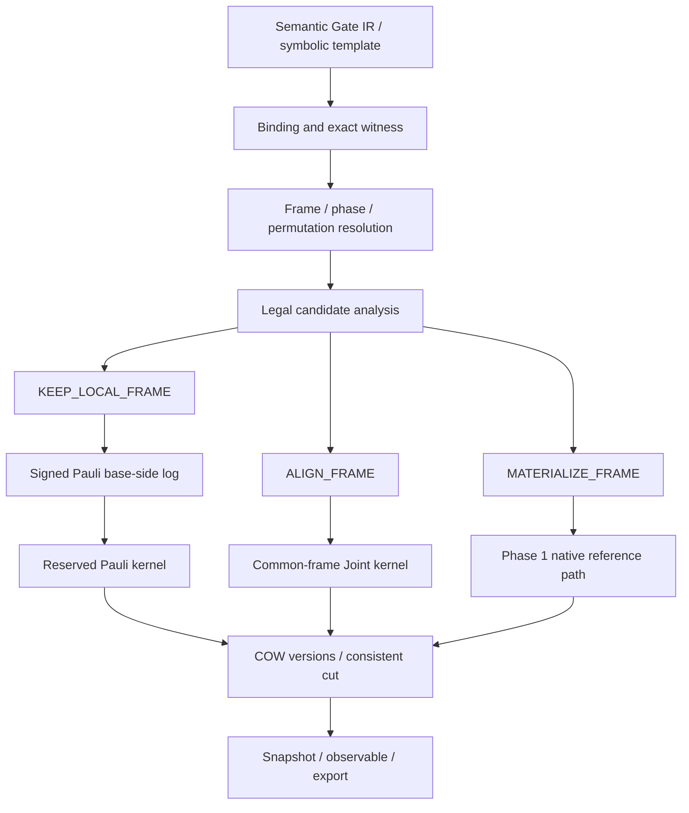

# Phase 2 設計書：Clifford／Non-Clifford の統合

- 作成日：2026-10-13
- 状態：実装済み。仕様との差分・境界と実測値は[実装・検証資料](phase2_implementation.md)および[比較実験](phase2_benchmark.md)を参照。
- 対応仕様：[開発計画 §18 Phase 2](../plan/distributed_quantum_circuit_simulator_development.md#phase-2cliffordnon-cliffordの統合)、同計画 §2・§7。
- 前提：[Phase 1 設計書](phase1_design.md)、[実装と検証](phase1_implementation.md)、[実測比較](phase1_benchmark.md)。
- 開発環境：Python 3.12 以上、uv、NumPy、pytest。runtime の追加外部依存は原則不要。

## 1. 到達目標と範囲

Phase 1 の gate-sequence Frame を、位相を保持する Block-local Clifford tableau に置き換える。T/Rx/Ry/Rz と Pauli-string rotation を Frame 座標へ共役し、毎回 Frame を振幅へ適用せずに局所 Non-Clifford を処理する。Joint の前には Frame を維持・整合・具体化する候補を合法性と費用から選ぶ。

| Phase 2 要件 | 成果物 |
|---|---|
| Block-local tableau | immutable Frame asset、符号付き Pauli 共役、合成・逆・局所適用列 |
| 相対位相 | tableau の代表元位相と named rotation の scalar を保存する PhaseValue |
| Block 置換 | upper X/CX/MCX/SWAP を表す版付き virtual permutation root |
| Non-Clifford 共役 | base-side PauliRotation log と容量制限付き kernel |
| symbolic guard | exact angle witness と Binding 専用 specialization、汎用 IR/Plan の維持 |
| cost heuristic | KEEP_LOCAL_FRAME / ALIGN_FRAME / MATERIALIZE_FRAME の候補・根拠・trace |
| 完了条件 | Clifford+T/Rz と既存 native/MCX/任意 U、観測量、snapshot が参照と一致 |

MPI、非同期 I/O、global Clifford Frame、FusedSWAP、勾配の外部記憶実行、性能劣化に対する自動 plan commit は後続 Phase。現在の Linux O_DIRECT／macOS F_NOCACHE と managed RAM 制限を継続する。

## 2. 現状の変更点

`storage.py` の Frame registry は serialized GateOp 列を intern し、`StoredSimulator._epoch()` は局所 Non-Clifford の前に Frame を flush する。`_joint()` は全入力 Frame/phase を identity に解消してから計算する。これは Phase 2 の安全な比較経路として残す。

`_compiled()` の事前 fusion は、Block ごとに共役先が異なることを扱わない。Phase 2 は入力 IR の構造最適化と、Frame 解決後の base-side log 最適化を分ける。`group_bits()` も Pauli mask と root permutation を理解する planner に拡張する。

Phase 1 の benchmark は Frame mode が常に高速になる結果ではなかった。tableau の更新や共役処理を無条件に優先せず、CPU、metadata、Cache、実際の I/O を含む費用を比較する。

## 3. コンポーネントと型

| 追加・変更先 | 責務 |
|---|---|
| `clifford.py` | bit-packed tableau、Pauli 共役、合成・逆、phase-sensitive anchor、deterministic synthesis |
| `frame.py` | immutable FrameAsset、FrameGroup rule、bounded cache、共有/COW、旧 sequence 変換 |
| `phase.py` | Z8 phase、exact pi multiple、symbolic phase、legacy complex multiplier |
| `pauli_rotation.py` | PauliRotation IR、base-side log、局所/partner kernel |
| `permutation.py` | symbolic upper-bit bijection、persistent root edge、逆 lookup・履歴 |
| `frame_planner.py` | 候補の証明条件、変換費用、policy、candidate decision |
| `parameters.py` | ExactPi expression/value witness、exact arithmetic の限定評価 |
| `planner.py` / `stored_runtime.py` | Frame-aware task、適用順、Joint 整合、Binding guard |
| `storage.py` / `checkpoint.py` / `journal.py` | schema v2、Frame/log/phase/permutation の永続化・移行 |
| `observable_plan.py` / `benchmark.py` / `telemetry.py` | 新しい表現での読み出し、校正、実測比較 |

| 型 | 主なフィールド |
|---|---|
| `SignedPauli` | x_mask、z_mask、sign_bit、physical bit convention |
| `CliffordTableau` | b、2b 個の X/Z image、各 image の符号、format version |
| `FrameAsset` | content ID、tableau、normalized phase anchor、synthesis ref、synthesis correction |
| `PhaseValue` | discrete Z8、exact pi coefficient、free expression refs、legacy complex、binding guard |
| `BaseLogRef` | shared log ID、base_coordinate_id、source cut、source ops、parameter dependencies |
| `PauliRotationOp` | SignedPauli、angle Expr、source Frame ID、Binding/guard ID、source op IDs |
| `FramePlanDecision` | 合法候補、選択候補、費用範囲、working-set、profile/model version、理由 |
| `PermutationEdge` | parent root、inverse rule、source layout/permutation ID、input/output cut |
| `SpecializedPlan` | template ID/version、Binding ID、witness hash、entry cut/layout/frame guards |



## 4. 状態表現と適用順

Block の保存振幅を `a_h`、適用待ち base-side log を chronological な列 `B1,...,Bm` とする。

$$
|\psi_h\rangle=\beta_h C_h L_h|a_h\rangle,
\qquad L_h=B_m\cdots B_2B_1.
$$

`beta_h` は相対位相を含む scalar、`C_h` は下位 b bit だけに作用する Clifford。Block は未正規化の振幅区間であり、どの段階でも Block ごとの正規化を行わない。

ここで `L_h` に入るのは Block-local 演算のみ。上位 X を含む Pauli rotation は root-level Joint log/task とし、partner pair の入力版・共同 cursor・共同出力を持つ。単独 Block の `L_h` として再生しない。次の Joint の入力前に局所 log を消化し、Joint の未完了部分を per-Block frontier の進行として公開しない。

後続の局所 Clifford G は Frame を左から更新する。

$$
G C_h L_h=C'_h L_h,
\qquad C'_h=G C_h.
$$

後続の Pauli rotation は次の共役で base-side へ移す。

$$
R_P(\alpha) C_h L_h=C_h R_{C_h^\dagger P C_h}(\alpha)L_h,
\qquad R_P(\alpha)=e^{-i\alpha P/2}.
$$

新しい rotation は chronological log の末尾に append する。既存 L の前へ並べ替えない。後続 Clifford が Frame を変更しても、すでに記録された base-side Pauli は再共役しない。

Frame の左合成と、base の座標変更を区別する。左合成では `base_coordinate_id` を維持する。Frame の具体化、共通 Frame への整合、物理 layout 交換で振幅の基底を変えた場合は coordinate ID を更新し、旧 log をそのまま新座標へ流用しない。

`physical_base_frontier`、`logical_frontier`、`applied_base_log_cursor` を分ける。`materialize(frontier)` は正しい表現として cut を進め、必要な amplitude task を実行する。Frame と局所 base log が残っていても state/export/expectation はその作用を含む値を返す。

## 5. Pauli と tableau の規約

qubit 0 は添字 LSB。Hermitian Pauli は次の規約を用いる。

$$
P(x,z,r)=(-1)^r i^{\operatorname{popcount}(x\land z)}X^xZ^z,
\qquad r\in\{0,1\}.
$$

tableau の行は **forward** image を保存する。

$$
T(X_q)=C X_q C^\dagger,\qquad T(Z_q)=C Z_q C^\dagger.
$$

`conjugate_forward(P)` と `conjugate_inverse(P)` を別 API にする。Non-Clifford を base 側へ移す場合は inverse を使用する。bit matrix の GF(2) inverse だけで符号を求めず、Pauli product の位相も追跡する。

内部積は非 Hermitian 中間値を許す Z4 exponent を使う。

$$
(i^sX^xZ^z)(i^tX^uZ^v)
=i^{s+t+2\operatorname{popcount}(z\land u)}X^{x\oplus u}Z^{z\oplus v}.
$$

Hermitian 入出力に戻すときに Y 個数と sign_bit を復元する。負の共役先は角度の符号へ反映する。H の Y→−Y、S の X→Y と Y→−X、CX/CZ の複数支持を独立テストする。

tableau は immutable。合成・逆は新しい asset を返し、共有 Frame を変更しない。symplectic 条件と X/Z の交換関係を decode/register 時に検証する。密な 2**b 行列で共役を実装しない。

## 6. tableau が失う位相と代表元

通常の tableau は Pauli 共役を定めるが operator 全体の scalar を定めない。[Stim の公式 tableau API](https://github.com/quantumlib/Stim/wiki/Stim-v1.13-Python-API-Reference#stimtableaufrom_circuit) も global phase を除いた変換を表す。この違いを Block 間で捨てると誤った相対位相になる。

### 6.1 採用する表現

本プロジェクトでは、tableau と **phase-sensitive な補助 stabilizer state** を組み合わせる。補助状態は Frame の `C|0...0>` だけを表し、任意 dense な `a_h` が stabilizer であるとは仮定しない。

補助状態の更新と振幅評価には CH-form の phase-sensitive 手順を採用する。CH-form が global phase を保持することは [Bravyi ほか、§4.1](https://arxiv.org/pdf/1808.00128) に記述されている。CH-form の非一意性と、Frame operator の代表元選択は本実装で別に扱う。

実装では phase-sensitive な affine-quadratic path sum と exact Z4 Gaussian elimination を採用した。canonical anchor の位相条件は同じで、CH-form への追加依存を必要としない。[実装資料](phase2_implementation.md#位相補助表現の変更)を参照。

各 tableau T の補助状態の support から、最小の計算基底添字 `j0` を決定的な GF(2) 手順で求める。次の振幅を正の実数にする operator を canonical representative `C0(T)` と定義する。

$$
\langle j_0|C_0(T)|0\rangle>0.
$$

同じ Pauli image とこの位相条件で Clifford operator は一意に決まる。Frame asset ID は b、bit/row convention、signed tableau の canonical bytes と format version から作る。非一意な CH serialization 自体を equality key にしない。

G を合成したときは tableau と補助状態を更新し、新しい `j0` の振幅位相を抽出して normalize する。

$$
G C_0(T)=\omega^k C_0(T'),\qquad \omega=e^{i\pi/4}.
$$

`omega**k` を Block の PhaseValue へ移す。named Clifford generator の discrete phase は整数 mod 8 で追跡し、float の atan/許容誤差で整数を推定しない。X/Z/SWAP は H/S/CX/CZ の正確な列へ変換して補助状態を更新できる。

CH の scalar と非ゼロ振幅は root-of-unity exponent と 2 の半整数 exponent で扱う。support の解法・H 更新での消去・phase 抽出に大きな dense state や浮動小数点のゼロ判定を使わない。decode 時に tableau の Z images と補助状態の stabilizer が一致することも検証する。

### 6.2 振幅への作用

deterministic symplectic elimination から有限の H/S/CX 系 synthesis word `W(T)` を作る。W 自身の補助状態を評価し、canonical representative との差の discrete correction を保存する。kernel は W と correction を合わせて `C0(T)` を実行する。

correction の向きは次に固定する。

$$
W(T)=\omega^q C_0(T),\qquad C_0(T)=\omega^{-q}W(T).
$$

W の適用後は `omega**(-q)` を作用させる。前節の Frame 左合成で Block phase に加える `omega**k` と別の値であり、両者を同じ符号で代用しない。

canonical synthesis の gate order/pivot 規約は format version に固定する。synthesis cache を bounded にし、登録されたゲートの長さに比例する旧 word を恒久保存しない。CH anchor、tableau、synthesis は b の多項式サイズで管理する。

位相抽出・CH update・synthesis が検証を通るまでは旧 sequence を保持した比較経路を使う。異なる word が同じ T を与える場合も、代表元位相を検証せずに merge しない。たとえば `(HS)^3` は identity tableau でも scalar が残るため、必須回帰試験とする。

### 6.3 PhaseValue

discrete Z8 に加え、exact rational pi coefficient、symbolic expression、旧 snapshot の complex multiplier を保持する。T の scalar は π/8 なので Z8 だけでは表現しない。自由な scalar は PhaseValue 側へ集約し、canonical Frame asset の比較を妨げない。

legacy complex phase を「ほぼ 1」「ほぼ i」として exact phase に変更しない。共通位相を正規化する場合も全体系共通と証明できる一つの値だけに限定する。初期版はこの全体系正規化を行わない。

## 7. Non-Clifford の lowering と base log

### 7.1 named rotation と T

Rx/Ry/Rz は Hermitian X/Y/Z rotation として扱う。T と T† は scalar を含めて変換する。

$$
T=e^{i\pi/8}R_Z(\pi/4),\qquad T^\dagger=e^{-i\pi/8}R_Z(-\pi/4).
$$

Frame 共役後の signed Pauli と symbolic angle を journal の派生 record に保持する。original GateOp は正本として残し、native apply と派生 log を二重実行しない。

下位だけに作用する C は、下位 Pauli の支持を増やしても同じ Block 内に保つ。support weight/stride が増える CPU・fusion 費用を比較する。固定 layout の Block-local Frame による共役だけで上位 bit に支持が生まれるとは扱わない。

### 7.2 control と任意 U

上位 control は Block ごとの定数なので、predicate が成立する group だけで局所 rotation と scalar を扱える。下位 control を含む rotation、MCX、多くの任意 U は、control projector も Frame で変換され得る。

初期 KEEP は **局所 Pauli rotation または上位 control により選ばれた局所 Pauli rotation**を必須範囲にする。下位 control の共役を単に同じ computational predicate とみなさない。証明済みの predicate-preserving 条件がなければ Frame を具体化して元 native GateOp を適用する。

MCX は残る局所 control 数が 0/1 の場合だけ局所 Clifford 候補。2 個以上は専用 predicate kernel を維持する。任意 U(2)/U(4)/U(8)/U(16) と structured-exact lowering も Phase 1 の native/比較経路を維持する。数値的に近い U を Clifford と分類しない。

### 7.3 log、fusion、上限

base log は immutable shared sequence/DAG として intern し、Frame group と base coordinate が共通なら payload を共有する。角度は Expr のまま保持し、適用時に guard を確認して bind する。

隣接 base-side rotation が同じ signed Pauli、同じ座標、同じ predicate を持つ場合に角度を合成できる。符号は角度へ正規化する。metadata 上で Clifford を左合成しただけなら座標は変わらないが、共役解決前の logical IR で非隣接演算を交換しない。

log の長さ・serialized bytes・expression depth に上限を設け、予算を超える前に安全な prefix を kernel へ反映する。反映した cursor と新 base version を記録し、eviction/replay で二重適用しない。base log を消化しても Frame を保持できる。

## 8. Pauli-string rotation kernel

Pauli の基底作用と回転の出力は次の通り。

$$
P|j\rangle=(-1)^r i^m(-1)^{\operatorname{parity}(z\land j)}|j\oplus x\rangle,
\qquad m=\operatorname{popcount}(x\land z).
$$

$$
a'_i=\cos(\alpha/2)a_i
-i\sin(\alpha/2)(-1)^r i^m
(-1)^{\operatorname{parity}(z\land(i\oplus x))}a_{i\oplus x}.
$$

parity は **source index** で評価する。Y、負の Pauli、複数 Y でこの向きを検証する。

- x=0：対角 multiplier。chunk 単位で更新し、不要な partner read を行わない。
- 下位 x≠0：unordered offset pair を一度ずつ処理する。両入力を scalar scratch へ退避してから両出力を書く。
- 上位 x≠0：partner は `h xor x_upper`。上位 X の個数に関係なく Pauli rotation は Block pair であり、全 2**popcount 個の Block を確保しない。
- 上位 Z だけが含まれる場合：その parity を group ごとの signed angle に移し、局所 kernel または Block phase として扱う。
- Pauli=I：scalar rotation であり、角度を無条件に identity として削除しない。

caller-owned buffer、mmap page の実予約、入力不変、出力 COW を継続する。状態全体の添字配列や dense Pauli 行列は作らない。上位 X を含む場合、異なる Frame のまま同じ Pauli kernel を適用せず、次節の整合または identity 化を先に行う。

## 9. Joint 前の KEEP／ALIGN／MATERIALIZE

### 9.1 共通 Frame への整合

候補 Frame を R、その phase を beta_R とする。各入力の base log をまず消化し、次を計算する。

$$
|\widetilde\phi_h\rangle=
\frac{\beta_h}{\beta_R}C_R^\dagger C_h L_h|a_h\rangle.
$$

入力 pair A/B の上位 H なら出力は次となる。

$$
|\phi'_A\rangle=(|\widetilde\phi_A\rangle+|\widetilde\phi_B\rangle)/\sqrt2,
\qquad
|\phi'_B\rangle=(|\widetilde\phi_A\rangle-|\widetilde\phi_B\rangle)/\sqrt2.
$$

両出力の Frame/phase は R/beta_R。A を R に選べば開発計画 §2.3 の式になる。入力 buffer を破壊せず、両 output version、log cursor、coordinate ID を一括公開する。

### 9.2 合法性を先に判定する

uncontrolled な上位 H、上位だけの U と一定の上位 control は、共通 Block-local Frame と commute するので ALIGN 後も Frame を保持できる。

上位/下位を含む Pauli rotation は、全 partner を同じ Frame にした後に下位 Pauli を共役して Joint Pauli kernel を実行できる。複数 Block に固有 Frame があるまま単一 Pauli へ共役できるとは仮定しない。

下位 control の上位 H/MCX、局所支持を含む一般 Joint Dense、物理 layout 交換は、共通 Frame との commute を証明できなければ MATERIALIZE を選ぶ。変換後の一般行列を 2**b 次元へ拡張しない。

`C_R† C_h` 自体の discrete correction を必ず含める。tableau が等しく phase だけ異なる場合は Frame 変換不要でも scalar 整合は必要。

## 10. Frame Group と metadata 負荷

asset registry、conjugation memo、synthesis/CH cache を byte 上限付きにする。未使用 asset は SQLite から必要時に読み、全 Frame を Python dict に保持しない。memo key は Frame ID、Pauli、layout、coordinate/format version。

共有 Clifford 更新は root の Frame transform rule、上位 control は mask/range predicate と COW override で表す。pure metadata 操作の登録時に全 Block の view row を更新する Phase 1 の経路を改善する。

rule は source root/cut と permutation context に固定する。lookup 時に必要な Block だけを解決し、同じ旧 Frame→新 Frame の合成結果を共有する。連続した共通 Clifford rule は tableau 合成で圧縮できる。条件付き rule の順序は保つ。

rule depth/group fragmentation が上限に達した場合は、同じ作用を表す compact candidate を cost とともに提示する。大規模な metadata scan を登録時に黙って実行しない。必要な disk index compaction は明示 task とし、RAM 上限と metadata I/O trace を持つ。

synthetic metadata 試験では b=24、n=40/50 相当の Block ID 空間を amplitude なしで扱い、共有 H/S/CX 更新と条件付き分岐で physical journal/asset/rule が Block 数分の Python object に展開されないことを確認する。

## 11. 相対位相と virtual Block permutation

全対象/control が上位の X/CX/MCX/SWAP は、Block 内 offset を変えない可逆 bijection f として扱う。これは入力回路の論理作用であり、QubitLayout を変更しない。

root edge に `parent_root` と f の inverse rule を保存する。

$$
\operatorname{view}(root',h)=\operatorname{view}(root,f^{-1}(h)).
$$

振幅版だけでなく Frame、phase、base log、cursor を一緒に移す。更新後に到着する局所/上位条件は **現在の h** で評価する。過去の upper parity や predicate は source root の座標に固定し、新 label で再評価しない。

root lookup は各 edge を降りるたびに h を変換して inherited view を解決し、child override はその child の label で優先する。symbolic rule を bounded に保持し、全 Block の permutation array を作らない。inversion、重複適用、chain depth、catalog flatten、GC の参照閉包を更新する。

snapshot/export/observable/partner planner は permutation を解決してから物理 bit の作用を決める。Cache key は immutable version に基づくため、同じ base を読めても logical label と phase を取り違えない。

`physical_index_bit_swap` は別の layout barrier。Phase 1 の実データ転置を継続し、入力の permutation、base log、Frame/phase を解決して新しい root を作る。完了時に layout と root を同時更新し、出力の permutation を identity に戻す。仮想置換を物理 SWAP の転送量として誤って 0 計上しない。

## 12. exact angle と Binding 専用 guard

### 12.1 exact witness

Expr に `ExactPi(numerator, denominator)` を追加する。canonical serialization は整数 pair を既約化して保存する。Binding は numeric projection に加えて optional exact witness と witness hash を持つ。full Binding ID は両方を含める。

finite binary float はその正確な有理値として扱えるが、`float(pi/2)` を exact π/2 と認識しない。exact analysis は定数/記号の証明済み加減乗除と限定した既知 sin/cos 値だけに行い、不明は unknown。float 演算の underflow/cancellation 結果が 0 という理由だけで exact witness を作らない。

固定 GateOp の構造証明と、特定 Binding でだけ成立する性質を区別する。Binding engine が witness と numeric projection の一致を検証し、ユーザー提供文字列を eval しない。

### 12.2 Clifford と scalar を一緒に特殊化する

exact quarter-turn の Rz は次の scalar を保持する。

$$
R_Z(k\pi/2)=e^{-ik\pi/4}S^k.
$$

特に Rz(2π) は −I であり、上位 control の selected Block に吸収した場合は相対位相が残る。Rx/Ry と一般 Pauli quarter-turn も正確な Clifford synthesis と scalar を組で登録する。

specialization は Binding ID、witness hash、layout、entry Frame/coordinate、frontier を guard に持つ別 plan。汎用 GateOp/PlanTemplate を書き換えず、別 Binding へ流用しない。近似 Clifford 化は Phase 2 の既定機能にしない。

prefix reuse は Phase 1 と同じ parameter dependency に基づく。値依存 identity/Clifford 化だけで共通 prefix を延長しない。legacy Binding は exact witness なしで読み、過去の float angle を exact π へ解釈し直さない。

exact witness がない Binding の hash は v1 の canonical numeric hash と互換に保つ。witness 付き Binding は v2 の typed payload を hash し、同じ float projection でも別 ID とする。guard は engine/plan format version も検査し、旧 execution plan を無検証で再利用しない。

## 13. cost heuristic、RAM、trace

選択前に kernel capability、predicate、Frame の作用空間、commute 条件、Binding guard、working-set を検証する。合法候補だけを費用比較する。

| 候補 | 費用に含める項目 |
|---|---|
| KEEP_LOCAL_FRAME | tableau 共役/phase 更新、group/log metadata、Pauli support/stride、必要な base 読込・COW、後続の Frame 解消 |
| ALIGN_FRAME | 入力 log 消化、差分 Clifford synthesis と scalar 整合、全 input/output 予約、Joint、残す Frame の将来費用 |
| MATERIALIZE_FRAME | 入力 log 消化、各 Frame の full apply、identity native/Joint、COW、後続 Frame 管理 |
| virtual permutation | root/rule 更新、lookup depth、将来 compaction、後続 predicate 解決 |

Stage 1 に tableau/CH update、共役、canonical synthesis、Frame apply、Pauli rotation の小規模 calibration を追加する。既存 storage の同一負荷条件付き profile を使い、Cache hit・dirty state・mmap page・slot padding・metadata I/O を分ける。

候補の推定は profile/model version を持ち、差が不確かなら Phase 1 の safe materialization を選ぶ。local Clifford の通常 Frame 更新は維持する。KEEP/ALIGN の正確性比較には強制 policy を用意し、非合法な強制候補は説明付きで拒否する。読み出しを伴わない KEEP でも将来 I/O を 0 と決めつけない。

予測窓は次の Joint/layout/measurement barrier まで。future task の speculative reordering はしない。choice を journal/trace に記録し、resume では入力版・guard に一致するものだけ replay する。Phase 2 の選択は task 局所の表現選択で、Runtime Performance Guard の自動 plan commit とは分ける。

metadata と packed tableau/CH/synthesis cache も byte 予約する。Pauli pair は二つの入力または整合 buffer と二つの出力、scratch を予約し、足りなければ状態変更前に拒否する。process RSS と managed RAM の区別、caller-owned 出力の扱いは Phase 1 を維持する。

trace は source ops、frame before/after、phase delta、coordinate/log cursor、Pauli masks/sign、support weight、選択/却下理由、予測費用、実測 Frame/Pauli/metadata/I/O 時間、転送 bytes、Binding/guard/permutation/layout ID を持つ。内包時間を重複加算しない。

## 14. Snapshot v2 と観測

snapshot v2 は canonical Frame/anchor/correction、PhaseValue、BaseLogRef/cursor、base coordinate、permutation edge と root、Binding witness、source/derived frontier、format/semantics version を保存する。

Phase 1 v1 は read adapter で sequence を読み、phase-aware tableau へ変換する。旧 complex phase と新しい代表元 correction を積で保存し、振幅を変更せず migration を行う。元の v1 snapshot を上書きしない。legacy circuit hash の検証には v1 serializer を使い、変換後の derivation/version を別に記録する。

catalog の v1 integer Frame ID と v2 content ID は混同しない。v2 registry、base-log、phase、root-edge 用の新規 table と旧 ID→新 asset/phase の adapter mapping を追加し、旧 `views`/`frames` を破壊的に置換しない。schema/user_version を検査し、変換は新 root と snapshot で atomic に公開する。metadata-only migration は旧 immutable amplitude extent を共有する。

commit は Phase 1 と同じ segment/journal sync→catalog atomic transaction。参照先 asset/log/permutation の閉包も検証する。未消化 base log を含む consistent cut は保存できるが、Joint/layout task の部分出力を cut にしない。

observable の初期経路は、借りた work buffer で base log、canonical Frame と phase を解消して既存 Block pair 内積を使う。測定のために shared snapshot を変更しない。一般の異なる Frame pair を無条件に一つの共役 Pauli として評価しない。

将来の metadata-only observable 共役は、同じ Frame が全必要 partner に作用する場合等の proof として分離する。Phase 2 の完了条件にこの追加最適化や disk adjoint は要求しない。

## 15. 公開 API 案

```python
from svsim import StoredSimulator, StorageConfig, ParameterSymbol, ExactPi

config = StorageConfig('scratch/phase2', block_bits=18,
                       ram_budget_bytes=64 * 1024**2, backend='direct')
with StoredSimulator(24, config, frame_policy='auto') as sim:
    theta = ParameterSymbol('theta')
    sim.gate('H', (0,))
    sim.gate('CX', (0, 1))
    sim.gate('T', (1,))
    sim.gate('RZ', (0,), angle=theta)
    sim.gate('PAULI_ROT', (0, 1), paulis=('X', 'Y'), angle=theta / 2)
    prefix = sim.commit_prefix((theta,))
    with sim.fork(prefix, binding=sim.bind({theta: ExactPi(1, 2)})) as run:
        run.materialize()
        checkpoint = run.commit_snapshot()
```

Phase 1 の Gate API は維持する。`PAULI_ROT` の targets 順と Pauli 文字を検証し、identity も保持する。x/z mask は logical IR と physical execution で明確に分ける。binding float API は継続利用できる。

既存 `mode='eager'/'batching'/'deferred-no-frame'` を比較経路とし、`frame_policy='auto'/'keep'/'materialize'`、Joint の `alignment_policy='auto'/'input-a'/'input-b'/'identity'` を追加する。強制 policy も合法性と RAM 条件を満たす範囲だけを実行する。

## 16. 検証と実装順

| 順序 | 作業 | 合格条件 |
|---|---|---|
| 1 | SignedPauli、tableau forward/inverse/product | 1〜4Q dense oracle で符号を含む共役・合成・逆が一致 |
| 2 | CH anchor、canonical representative、synthesis correction | 全体位相を揃えずに word の作用が一致、同じ T の異位相を区別 |
| 3 | registry、PhaseValue、v1 adapter | frame sharing/COW、旧 snapshot の未正規化振幅と相対位相を維持 |
| 4 | base log と Pauli kernel | source parity、Y、負符号、T scalar、順序、apply cursor、RAM 上限 |
| 5 | Joint alignment と cost decision | 異 Frame/phase の上位 H、両 anchor 候補、identity fallback、原子的出力 |
| 6 | exact witness と specialization | 近い float は非吸収、ExactPi は scalar 込み吸収、別 Binding/guard 不一致拒否 |
| 7 | virtual Block permutation と group rule | layout 不変の論理作用、Frame/phase/log の移動、後続条件、replay/GC |
| 8 | snapshot/observable 統合・比較実験 | 8/10/12Q と RAM より大きい状態で参照一致、trace で費用説明 |

具体的な必須 regression は以下。

- H/S/X/Z/CX/CZ/SWAP のランダム word と `(HS)^3`、tableau identity だが異なる scalar の Block 間 H。
- H→T→S→Rz、CX→Rz の広がった Pauli、Y→−Y、複数 Y、identity Pauli、upper Z parity。
- Rz(2π)、control 値 0/1、未正規化 Block、zero Block、全体系 phase と Block 相対 phase。
- KEEP/ALIGN/MATERIALIZE の同一入力、A/B の異なる Frame・base log、Non-Clifford controlled native fallback。
- upper X/CX/MCX/SWAP の逆・合成、仮想置換後の control、物理 SWAP、snapshot・observable・export。
- float π/2 と近傍値、exact witness、bound 値による specialization、prefix COW と fingerprint 不一致。
- dirty Cache、eviction、log 部分消化、checkpoint/resume、write/flush failure、古い cut への rollback。
- metadata-only n=40/50 相当、bounded registry/memo、group 分岐、rule depth、managed peak と RSS。

NumPy eager reference とは **global phase を最適に揃える比較をせず**、complex128 振幅を直接比較する。小規模 Clifford identity/operator テストは絶対誤差 1e-12、8〜12Q 回路は 1e-10 を初期上限とし、長い word の累積誤差と許容理由を別報告する。期待値も参照と比較し、状態誤差を観測量だけで見逃さない。

実行は `uv sync`、`uv run pytest`。optional な外部 tableau oracle を導入する場合も global phase の oracle にそのまま使わない。runtime は native NumPy と標準ライブラリで動作する。

最終 benchmark は Phase 1 baseline、tableau＋常時 materialize、強制 KEEP、各 ALIGN、auto を同じ状態・回路・精度・budget・backend で比較する。compile/CH/synthesis、group/log bytes、Frame/Pauli CPU、I/O、snapshot と end-to-end を含め、改善した条件と悪化した条件を記録する。MPI 性能や全回路での速度向上は Phase 2 から主張しない。
