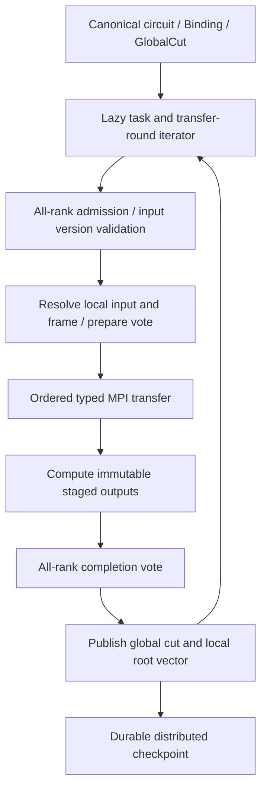

# Phase 3 設計書：MPI＋ストレージ階層

- 作成日：2026-10-13
- 状態：実装予定。本書の新規 module・API・性能値は未実装。
- 対応仕様：[開発計画 Phase 3](../plan/distributed_quantum_circuit_simulator_development.md#phase-3mpiストレージ階層)、同計画 §3.4・§3.12〜3.14・§16。
- 前提：[Phase 2 実装・検証](phase2_implementation.md)、[Phase 2 比較実験](phase2_benchmark.md)。
- 開発時の参照：[Mac Studio 単体 MPI 資料](../ref/mac_studio_mpi_quantum_simulator.md)。資料の独自 Phase 番号とファイル配置例は、本計画の Phase 番号・集約 segment 方針へ読み替える。

## 1. 到達目標と境界

単一プロセスの Block runtime を 1/2/4 MPI rank へ拡張する。各 rank は複数 Block を担当し、rank-owned RAM と SSD/HDD を使う。Frame、相対位相、遅延 log、Binding、layout、virtual permutation を含む同じ論理状態を、分散した一貫 cut として実行・保存する。

| Phase 3 要件 | 成果物・合格条件 |
|---|---|
| MPI Transport / Joint | typed buffer 通信、固定 rank・確定した通信 round、local/remote の同一結果 |
| MCX partial exchange | upper target＋lower control の packed/full 経路、0〜6 control、open control、実送信量と packing 費用 |
| prefix 共有 | immutable checkpoint の参照、Binding ごとの COW、固定 witness/frontier/layout/ownership guard |
| S0/S1 physical SWAP | global/rank-local/block-local bit 間の実転置、logical SWAP との区別、ゲート順序維持 |
| State/Operation/Frame shipping | 入力版・表現・権限・応答先を明示し、古い応答の誤採用を防ぐ |
| 性能観測 | rank/peer 別の計測条件付き MPI profile と trace、slow rank の検出、observe-only |
| 期待値 | partner 取得、複素部分和、Allreduce。全振幅 Gather を使わない |
| Adjoint | forward/adjoint の 2 状態を storage で逆再生、共有 Pauli 内積、式の chain rule、勾配 vector reduction |
| 完了 | 2/4 rank の MPI＋SSD が NumPy 参照と一致し、期待値・勾配・trace・checkpoint 再開も一致 |

Phase 4 の nonblocking MPI pipeline、io_uring、prefetch、background execution、自動再計画、S2 の gate reorder/FusedSWAP は含めない。Phase 3 は同期 task/round による正しさを先に確立する。MPI rank 脱落後の communicator 継続、実行中の rank 数変更、GPU、独自 shared-memory backend も対象外。

## 2. 現在の実装から変える箇所

`StoredSimulator` と `FileBlockStore` は一つの SQLite catalog と allocator を使う。各 rank が同じ catalog を writable に開く方式にはしない。rank ごとの catalog/allocator に分け、その root vector を GlobalCut がまとめる。

`Phase2Catalog` の規則と Frame asset を再利用し、global Block ID を local ordinal と取り違えないように iterator、view lookup、initial-one、partner generator を置き換える。`initial-one` は global h=0 の旧 base のみに属し、virtual permutation 後の入力 label で判定する。

`streaming_expectation` は現在単一 process。`observables.adjoint_gradient` は全中間状態を RAM に保存する小規模 oracle で、PAULI_ROT 等の新しい generator の検算も必要。これらを実 MPI や out-of-core adjoint の完成済み実装として扱わない。

| 新規・変更先 | 役割 |
|---|---|
| `distributed.py` | DistributedSimulator、collective API、global cut、stage lifecycle |
| `ownership.py` | symbolic shard ranges、versioned extent owner directory、placement epoch |
| `mpi_transport.py` | communicator 管理、typed transfer、bounded header/chunk、trace |
| `distributed_plan.py` | lazy task iterator、global admission、通信 round、S0/S1 |
| `block_store.py` / `storage.py` | 共通 Store API、bounded MemoryBlockStore、rank-local FileBlockStore |
| `distributed_checkpoint.py` | rank prepare manifest、global durable commit、prefix lease、resume |
| `distributed_observables.py` | source-owned complex inner product、observable grouping、Allreduce |
| `distributed_adjoint.py` | Pauli action、2-stream reverse、generator/projector、chain rule |
| `benchmark.py` / `telemetry.py` | MPI/mixed calibration、condition matching、slow-rank report |
| `examples/phase3*.py` / MPI tests | RAM reference、MPI＋SSD、MCX、SWAP、期待値・勾配・restart |

単一 process API と通常の `import svsim` は MPI 初期化を行わない。MPI を使う module でのみ optional dependency を import する。

## 3. MPI/uv と開発環境

`pyproject.toml` の optional extra `mpi` に `mpi4py` を追加し、uv.lock を更新する予定。Python は既存の 3.12 環境、NumPy と uv を継続する。Homebrew Open MPI 等の system MPI は uv の Python lock と別に管理し、実行レポートへ implementation/version を保存する。[mpi4py の installation](https://mpi4py.github.io/mpi4py/stable/html/install.html) を基準に実装時の対応版・ABI を確認する。

```sh
# 実装時に使う想定コマンド。現時点で mpi extra / examples は未作成。
brew install open-mpi
uv sync --locked --extra mpi
uv run --extra mpi python -c 'from mpi4py import MPI; print(MPI.Get_library_version())'
mpiexec -n 4 .venv/bin/python -m mpi4py examples/phase3.py --directory /tmp/svsim-phase3
```

起動は workspace の `.venv/bin/python` を明示して別 Python を選ばない。全 rank の Python/NumPy/MPI、byte order、dtype size、schema、source hash、Binding/witness、plan hash を起動 handshake で照合する。

初期 runtime は MPI 呼出しを main thread に限定する。既存 MPI 初期化を尊重し、`Query_thread()` で利用可能な thread level を記録する。library import で勝手に finalize しない。CLI は [mpi4py.run](https://mpi4py.github.io/mpi4py/stable/html/mpi4py.run.html) を使い、未処理例外で他 rank が finalize 待ちになる事態を避ける。

Mac Studio の複数 rank は、統合メモリ・SSD 帯域を共有する。同一 host の実測 profile は `same-host` として保存し、`cross-host` の NIC profile に転用しない。実機仕様・空き RAM・SSD 容量は実行時に検出し、参考資料の 512 GB 構成を固定前提にしない。

## 4. Block ID、shard、extent owner

n qubit、Block 幅 b、P=2**r rank、k=n-b-r とする。初期対応は P=1/2/4、P<=2**(n-b)、k>=0。非 2 冪 rank は明示拒否し、4/8 rank の性能検討は同じ規約で拡張する。

$$
h=(s\ll k)|u,\qquad A(h)=s=h\gg k,\qquad 0\le u<2^k.
$$

A(h) は **その logical view の metadata shard owner**。物理 bit は `[0,b)` が Block 内、`[b,b+k)` が同一 shard の Block bit、`[b+k,n)` が初期 rank bit。各 rank は `2**k` 個の view を range iterator で扱う。全 Block ID 配列を作らない。

一方、immutable extent は `(dataset_id, store_id, version_id, storage_rank, segment, offset, checksum)` で識別する。`storage_rank` は現在の A(h) と一致しなくてよい。virtual permutation、prefix 参照、Operation shipping の後は別 rank の extent を参照し得る。

`PlacementMap(version)` は shard rule と extent location を分ける。Block view は global h と root/cut から解決し、Frame/log/phase と extent owner をまとめて返す。物理 bytes の所有 rank を `rank xor mask` で決めない。XOR peer 式を使う fast path は、現 placement がその関係を満たすと検証できる場合だけ。

virtual root edge を遡る途中で `f^-1(h)` の shard が変わる場合、旧 shard の catalog へ metadata lookup を routing する。root vector、source h、source layout、rule format を request に持ち、rule を新 label で再評価しない。規則は bounded に複製し、override は所有 shard の disk index に保存する。

## 5. Store と rank ごとの容量

```text
dataset/
  global/manifests/                    # durable global checkpoint commit
  rank-0000/metadata/catalog.sqlite3
  rank-0000/state/segment-000000.bin
  rank-0000/journal/...
  rank-0000/assets/...
  rank-0000/traces/...
  rank-0001/...
```

Block ごとのファイルを作らず、rank ごとの append-only 集約 segment を維持する。既存 Linux O_DIRECT／macOS F_NOCACHE と caller-owned aligned buffer を使う。MPI-IO は初期 backend にしない。

RAM backend は bounded MemoryBlockStore を同じ version/view API の下へ置く。live root/prefix の参照閉包を予算化し、current/next stage の 2 世代を確保できない RAM-only job は admission で拒否する。RAM snapshot を durable にする場合は rank segment へ streaming export する。MemoryStore の volatile cut を restart 可能な checkpoint とみなさない。

rank-local SSD は各 rank しか書かない。multi-node の checkpoint は各 rank store が restart 時にも取得可能な構成を前提とし、local disk を失った node の bytes を MPI metadata だけで復元できるとはしない。共有 filesystem 上でも rank ごとの allocator と immutable extent を使う。

managed budget は **rank ごと**に `metadata＋cache＋input/output＋MPI send/recv＋packing＋reduction/scratch` を含む。同一 Mac では全 rank budget の和と MPI/OS/process RSS の余裕を host admission で確認する。MPI 実装内部 buffer と OS cache は managed budget の外として報告する。

Block payload B=16*2**b、page/alignment を含む lease cost L(B)、通信 tile cost L(T) を使う。二入力・二出力の同一 rank pair は metadata＋4L(B)。別 rank で各 owner が一出力を計算する full pair は、一入力・一出力・一受信 Block と転送 staging の実際の同時 lifetime を task graph で予約する。source/destination が異なる追加 fetch buffer も数える。

通信 chunk だけを小さくしても、Frame を任意 tile に作用できるわけではない。初期版は full Block の borrowed work buffer で Frame/base log を解消してから転送する。一般 g-Block Dense は bounded coordinator 上の input/output group と転送 tile を予約する。収まらなければ S1 での局所化・合法な structured-exact 分解を比較し、候補がなければ実行前に拒否する。tile kernel による full working-set の削減は別の検証済み capability とする。

## 6. Transport、通信 round、global stage

振幅は contiguous `<c16` array または canonical byte buffer を、大文字 buffer API で送る。Python object の pickle を振幅経路で使わない。[mpi4py tutorial](https://mpi4py.github.io/mpi4py/stable/html/tutorial.html) の buffer API を利用する。heterogeneous endian は初期対応外として handshake で拒否する。

`control_comm` と `data_comm` を duplicate して分離する。header は canonical JSON/typed bytes、長さ上限と hash を検査し、振幅とは別の metadata bytes として計数する。message は `run_id/binding_id/stream_id/task_id/stage_seq/root/input_version/layout_id/placement_epoch/representation/tile_seq/count` を持つ。

tag は MPI.TAG_UB の範囲内の固定 channel を使い、task ID をそのまま tag に詰めない。初期版は one outstanding round とし、前 round 完了後に tag を再利用する。source/peer を指定し、ANY_SOURCE で state response を採用しない。chunk count は min(設定上限、backend count capability) 以下とし、2 GiB 超を一回の MPI call で扱う前提にしない。

[Open MPI Sendrecv](https://docs.open-mpi.org/en/main/man-openmpi/man3/MPI_Sendrecv.3.html) を基本とし、旧 input の send buffer と recv buffer を分離する。peer 間の send/receive 順序は deterministic round で一致させる。同一 rank の fetch は Store API で行う。



最初は global task の順序を全 rank で同じ lazy iterator から生成する。task ごとに必要 rank と lexicographic `(source,destination,stream,h,tile)` 順の round を生成し、inactive rank も同じ control collective の順序へ参加する。一般多 rank group は coordinator と各 input/output owner の対を一つずつ処理し、cyclic blocking send の依存を作らない。

各 stage は入力 cut を pin→全 rank admission→I/O prepare vote→通信/compute→completion vote→root vector 公開。全参加者が成功するまで visible frontier を進めない。失敗時の staged output は到達不能な COW version として保留し、旧 global cut を authoritative にする。stage commit は volatile な整合公開であり、fsync 済み durable checkpoint とは別。

全 rank は data call 前に同じ plan/round hash を照合する。cache hit・空き容量・ローカル heuristic によって各 rank が独立に task/round 順序を変更しない。候補変更は control 合意で確定し、一 rank でも admission に失敗すれば全 rank が Sendrecv に入る前に拒否する。

通常の I/O/validation error は通信開始前の vote、または全通信完了後の vote で共同失敗にする。peer が blocking MPI 中に rank 消失した場合は、集約 error vote の成立を仮定せず job を停止する。[Open MPI error handler](https://docs.open-mpi.org/en/main/man-openmpi/man3/MPI_Comm_set_errhandler.3.html) は error 後の継続を保証しないため、`ERRORS_RETURN` だけで recovery を実現したとはしない。

## 7. gate と shipping

| gate / 状況 | 分散処理 |
|---|---|
| Block-local Clifford / upper predicate | source-coordinate rule/Frame asset 更新。振幅通信なし |
| upper Z/S/Rz/CZ 等 | global h と predicate から relative phase。control metadata 通信は計数 |
| upper-only X/CX/MCX/SWAP | virtual root permutation。extent 移動なし、必要な metadata owner lookup は残る |
| 同一 rank partner | Phase 2 の Joint/Pauli pair、MPI 不要 |
| rank 間 H/U / Pauli rotation | logical partner descriptor を取得し、full/packed state transfer＋ALIGN/identity path |
| 一般 Joint Dense | g<=16 の group を予約可能な coordinator に集め、native kernel 後に出力 owner へ戻す |
| lower control の Joint | predicate-preserving proof がない Frame は具体化。任意 Frame のまま offset packing しない |

2-owner 上位 H は旧 logical A/B の payload を一度ずつ交換し、A owner が `(A+B)/sqrt(2)`、B owner が `(A-B)/sqrt(2)` を書く。rank-local 所有配列の符号ではなく target bit の A/B label で決める。上位 X が複数ある Pauli rotation も `h xor x_H` の pair のみで、2**weight rank group を作らない。

初期の full state shipping は source owner が logical amplitude を解消して渡す。共通 Frame を保持する ALIGN 候補では、明示した canonical reference Frame と phase へ source 側で整合してから送る。message representation を `logical-identity`/`common-frame`/`immutable-base-with-descriptor` と区別し、Frame/phase を二重適用しない。

Operation shipping は、入力 extent が source rank にあり、必要な全 operand、Binding/witness、source coordinate、kernel asset、output budget がそこでそろう task に限る。source は immutable input から新 version を生成し、metadata shard へ staged descriptor を返す。joint operand が不足する場合は必要な fetch も費用に含める。

Frame shipping は content-addressed asset と phase/log descriptor の配送で、振幅の代替ではない。receiver が同じ immutable base extent を持つ/参照可能で、その log cursor と coordinate が一致する場合のみ作用の共有に使う。宛先が base を持たなければ State fetch が別途必要。hash/format と正規化位相を検証し、bounded asset cache へ登録する。

## 8. MCX conditional partial exchange

upper target t の pair は `h'=h xor 2**(t-b)`。upper controls が成立する pair だけを選び、lower control mask/value を m/v とする。active offset は `ell & m == v`、個数 a=2**(b-k_local)。両側が同じ昇順 offset/run generator で pack する。

$$
D_{pair}^{packed}=2\cdot16\cdot2^{b-k_{local}},\qquad D_{pair}^{full}=2B.
$$

これは二方向の **amplitude payload の和**。send＋recv を再び足して 2 倍にしない。header、representation fetch、Frame 解消、packing、padding、SSD の full Block read/write は別計上する。

1. 両 input の log/Frame/phase を identity 表現へ解消し、active predicate の基底を確定する。
2. source input と output COW Block を確保。output は自身の logical input をコピーする。
3. active offset を bounded tile に pack、Sendrecv で相手の旧 active values を受信。
4. output の active offset のみ scatter し、inactive offset を保持。旧 input を書き換えない。
5. 両 output を同じ joint stage で公開。出力は identity Frame と新 coordinate。

初期版の SSD working-set は Block 粒度。active 率 2**(-k_local) を SSD read/write 削減率とみなさない。packed/full/S1 の auto 比較は同条件の packing＋MPI＋I/O calibration がある場合のみ行い、未知条件では full exchange を選ぶ。比較用 `mcx_exchange='packed'/'full'/'auto'` を設ける。

## 9. S0/S1 physical index-bit SWAP

S0 は layout を変えず元ゲート順に実行する。S1 は同じ順序の barrier 間で、後続 gate の MPI 費用が交換費用を回収する場合だけ physical swap を挿入する。DAG reorder と FusedSWAP は Phase 4。

physical swap p/q は `i' = i xor (delta<<p) xor (delta<<q)`、`delta=((i>>p) xor (i>>q)) & 1`。入力の virtual permutation と Frame/log/phase を解消し、出力 bit 配置に対応する shard/extent へ実際の振幅を転送する。Block 内だけ、同一 rank の Block 間、rank 間の三種類を同じ indexing oracle で検証する。

lower↔rank bit は半 Block の offset routing、Block bit↔rank bit は full Block routing、rank bit↔rank bit は rank 間の対応領域 routing になる。placement indirection があると追加 source fetch が必要なので、初期 rank の式だけで転送量を決めない。

root vector、QubitLayout、placement epoch、inverse transition record を一緒に stage commit する。全 logical state は維持され、以後の gate/observable を新 layout へ lowering する。元回路の logical SWAP は別の semantic operation として維持する。

S1 の cost は再配置・COW write・Frame alignment・将来の transfer・export/reverse 時の layout 解決を含む。profile が未知、RAM/SSD 予算不足、正味改善の下界を確認できない場合は S0。比較では swap MPI/SSD bytes と downstream 削減を別々に示す。

## 10. 分散 checkpoint と prefix

GlobalCheckpoint は schema v3 として、dataset、source/semantics/plan hash、Binding 値/witness、global frontier、layout、placement epoch、virtual rule root、rank root vector、rank prepare-manifest hash、journal cursor、asset/log 閉包、初期状態 fingerprint を保存する。rank catalog も schema v3 とし、既存 v2 を基礎に dataset/store/owner/stream の namespace を追加する。未知 schema は DDL 前に拒否する。単一 rank v1/v2 checkpoint は P=1 adapter で読めるようにする。

**durable commit protocol** は次の順序。

1. quiescent global cut を固定し、全 rank が同じ frontier/Binding/layout/placement を検査する。
2. 各 rank が cache、segment、asset、journal、directory を sync。immutable prepare manifest を atomic rename＋directory sync で保存する。
3. prepare hash と durable-success vote を coordinator へ送る。失敗なら新 checkpoint を公開しない。
4. coordinator が global manifest を一時ファイルへ書いて fsync→atomic rename→parent directory fsync。これを唯一の durable commit point とする。
5. global checkpoint ID/hash を Bcast。通知失敗時も disk の global manifest が真実で、restart は commit 済み新 cut を選ぶ。

途中 crash の orphan prepare/version は旧 checkpoint の参照閉包を壊さず、job 再起動後の quiescent GC で回収する。rank-local prepare があるだけの cut を resume しない。coordinator failover/ULFM 継続は行わず、MPI job ごと restart する。初期 restart は同一 rank 数・rank store mapping に限定する。rank 数変更は offline repartition と別検証が必要。

coordinator の global manifest path も、宣言した durable storage mapping の一部として job/process restart 後に読み出せなければならない。coordinator node の disk 自体を失う障害は、別途 durable replication がない初期構成では復旧対象外。restart は global manifest の generation/hash を検査し、全 rank prepare と参照閉包を確認して最新の valid committed generation を選ぶ。rank prepare の存在から commit を推測しない。

prefix は最初の variable-dependent source gate の直前まで。値依存 identity/Clifford 化で延長しない。共有可能性は source prefix、initial state、固定値/witness、dtype/semantics、frontier、Frame/log/permutation closure、layout、placement、dataset/checkpoint schema を guard に持つ。

MPI rank 間の共有は shared Python pointer ではなく、immutable checkpoint/extent の参照。各 suffix は専用 run ID、catalog COW root、allocator/journal/trace namespace を持ち、別 Binding が同じ writable file を開かない。prefix Store は read-only proxy で開き、DDL・active-run 登録・Frame adapter の intern 書込も行わない。旧 Frame 変換の派生 asset は suffix catalog/cache に保存する。別の writable control sidecar に置く保守的な job/checkpoint lease が prefix GC を禁止する。remote prefix extent は State fetch/Operation shipping を通して使い、必要な転送を 0 とみなさない。

初期 parameter batch は同じ P rank が Binding を一つずつ共同実行する。並列 suffix は別 MPI job・専用 suffix directory を用い、共通 prefix を immutable に共有する。複数 Binding を同じ communicator の別 rank へ勝手に割り当てて異なる collective 順序にしない。

capacity admission は旧 cut＋全 staged outputs＋forward/adjoint＋共有 prefix の live extent＋dirty cache の書戻し＋segment tail/orphan/fragmentation を、rank store ごとの peak lifetime で数える。全状態更新中の old/new 共存により必要量は 2S を超える。

GC は global quiescent lease/pin set に snapshot handle、active stage、in-flight fetch、prefix fork、両 adjoint stream を含める。remote reference も source rank の segment を pin する。初期は Phase 2 と同じ whole-segment GC で、live extent が一つ残る mostly-dead segment を容量回復として数えない。外部 suffix job の lease が残る場合は保守的に拒否する。

reverse workspace の不要な祖先を解放するため、全 view coverage の証明または bounded disk metadata compaction で root を rebase し、旧 generation の参照を解除する。単に前 cut の handle を捨てても COW parent chain が残れば version は回収できない。rebase/GC の metadata I/O と必要な transient 容量を明示 task として費用・checkpoint closure に含める。

## 11. 分散期待値・共有内積

各 rank は ket の source view の shard A(h) により、担当 h の寄与を一度だけ加算する。bra の partner `h'=h xor x_H` は root/placement を解決して取得する。計算 owner が extent owner と違っても寄与の割当を変えない。

$$
\langle a|P|v\rangle = \sum_h i^{popcount(x\land z)}
\sum_\ell (-1)^{popcount(z\land((h\ll b)|\ell))}
\overline{a_{h\oplus x_H,\ell\oplus x_L}}v_{h,\ell}.
$$

parity は source index、bra/ket はそれぞれの Frame/log/phase を borrowed buffer で解消する。異なる Frame pair を一つの共役 Pauli として扱わない。`x_H=0` や upper Z のみでは amplitude MPI なし、最終 reduction と metadata の通信だけになる。

同じ x_H の observable term を grouped task とし、partner fetch を複数 observable で共有する。初期 reference は source-directed sum を採用し、unordered pair の 2 倍加算を混ぜない。gradients の一般 bra/ket では Hermitian の片側 conjugate shortcut を使わない。

bra/ket は異なる root・version・extent placement を持てるが、同じ global logical frontier/layout と対応する source Binding を表すことを fetch 前に検査する。role ごとの placement を独立に解決する。

**一方向 fetch の matching protocol** は global iterator が生成する一意の request ごとに実行する。key は `(task_id,request_id,bra/ket role,source h,partner h,root,input_version,representation,tile_seq)`。requester と extent owner が同じなら local read。異なる場合は次の順序を全 rank の round hash に含める。

1. request round：requester が bounded header を送り、owner が受ける。反対向きは zero-count。両者の Sendrecv source/destination と tag を明示する。
2. owner が版・表現を検証して read/Frame 解消、全 rank が prepare/error vote を行う。
3. response header/count round、次いで amplitude chunk round：owner→requester の一方向、反対向きは zero-count。request ID/version/representation/count を照合してから staged bytes を採用する。
4. 全 chunk 完了後に次 request へ進む。owner が自分の ket を送ると仮定せず、同じ役割の相互交換ともみなさない。

この保守的な初期 protocol は観測、adjoint、placement indirection による remote fetch に共用する。request aggregation と posted nonblocking receives は Phase 4 の最適化とする。

各 rank の compensated complex sum を typed `MPI.Allreduce(SUM)` へまとめる。observable 数が reserve を超える場合は同じ global batch 順序で chunk reduce。期待値のみ最後に imaginary residual を検査して real を返す。MPI reduction の加算順序差を許容誤差に含め、bitwise 同一性を要求しない。

## 12. out-of-core distributed Adjoint

初期対象は unitary 回路、実係数 Pauli 和による一つの scalar objective、RX/RY/RZ/PAULI_ROT の symbolic angle。固定 Dense U、MCX、T 等は逆伝播するが微分対象ではない。途中測定/noise と導関数不明の parameterized Dense は明示非対応。

$$
\psi_j=U_j\psi_{j-1},\qquad \lambda_m=O\psi_m,
\qquad (\psi_{j-1},\lambda_{j-1})=(U_j^\dagger\psi_j,U_j^\dagger\lambda_j).
$$

Pauli rotation の occurrence では **逆ゲート適用前**の aligned cut を使う。

$$
g_j=\operatorname{Im}\langle\lambda_j|P_j|\psi_j\rangle,\qquad
\frac{\partial E}{\partial\alpha_p}=\sum_j g_j\frac{\partial\theta_j}{\partial\alpha_p}.
$$

controlled rotation は generator `Q_control P` を使い、inactive identity branch の導関数を 0 にする。Frame を解消した computational predicate で projector を評価する。quarter-turn/identity に specialized した Gate も **元 symbolic gate の generator** を使い、その Binding で値が Clifford/identity だから勾配 0 とはしない。

`lambda_m=Σ c P psi_m` は term/partner group を streaming し、new adjoint extent に蓄積する。一般 bra/ket 共有内積を使うため、expectation の real-only reduction を勾配の complex overlap に再利用しない。lambda は正規化しない。

2 状態に `stream_id='forward'/'adjoint'` を付け、cache key/version/message namespace を分ける。入力 forward final snapshot は immutable、reverse workspace は COW。各逆 stage は両 stream を同じ logical frontier/layout/placement へ進めて一括公開する。論理 gate inverse と S1 physical layout inverse を別に replay する。

初期 kernel 統合は identity Frame に具体化した workspace を基準経路とする。Frame を保持する逆伝播は同じ proof 条件を満たすときだけ。Fusion/structured lowering の複数 source occurrence の勾配を消さないよう、reverse plan は source Gate IR の順序を正本とし、実行の派生 step と対応付ける。 source-occurrence→derived-step の mapping を plan hash とともに固定し、`dU/dalpha` は元 GateOp/Expr から各 occurrence ごとに求める。Expr derivative を fusion 後と source 側で二重に掛けない。requested parameter ID、Expr 内だけの依存、missing derivative metadata を API admission で検査する。現在の NumPy adjoint oracle は RX/RY/RZ を主に扱うため、PAULI_ROT/projector/specialization は独立した dense derivative oracle と finite difference を追加して照合する。

現在の 2 stream を SSD に置いて gate 逆再生し、全中間 state は保存しない。immutable final/prefix checkpoint と COW の live versions を含め、容量は `2S` の理論値だけで admission しない。古い workspace cut の参照を解除して GC 可能にし、途中 checkpoint を保持する場合はその閉包も数える。2 状態を同時に RAM へ載せず、一方ずつ更新する buffer lifetime を計画する。

parameter_id 順に local gradient vector を累積し、最後に一括 Allreduce。shared parameter と Expr derivative を chain rule で加算する。parameter 数が metadata reserve に収まらない場合は bounded disk accumulation と決まった vector chunk の reduction を使う。

Phase 3 は unitary inverse replay を完成条件にする。Revolve 型 checkpoint/recompute の最適化、多数独立 observable の並列 bra は後続。正しさ検証用 parameter-shift/central finite difference も source template と独立 Binding で実行し、rank 間通信と 2 状態 I/O を省略した性能評価にしない。

## 13. 校正・trace・slow rank

Stage 1 は rank/peer ごとに Sendrecv payload、message latency、packing/scatter、同時 SSD＋MPI、reduction、Frame alignment を測る。condition は host pair、same-host/cross-host、MPI implementation、dtype/message/tile size、placement、concurrency、warmup、storage backend/flush、profile version を含む。

transfer trace は application send payload、recv payload、metadata bytes、wait/elapsed、packing、local SSD read/write、source versions、Frame/layout/placement、task/source ID と実際の peer を持つ。total amplitude MPI は全 rank の **send bytes の和**を使い、recv を二重計数しない。MPI 内部 header/NIC wire bytes はこの値から推測しない。

Bandwidth は `send payload / measured transfer interval` 等の定義を固定し、双方向 aggregate と directional を分ける。MPI.Wtime の rank 間 clock が同期しているとは仮定せず、local elapsed と stage elapsed の MAX reduction を使う。I/O/MPI/CPU の内包時間を無条件に合算しない。

ObservePerformanceGuard の条件一致・連続 window・hysteresis を継続し、stage wall の MAX、rank/peer 別充足率、待ち時間の分布を記録する。平均だけで slow rank を見逃さない。未知 load condition は劣化判定しない。Stage 3 は observe/recommend に限定し、plan の自動切替は Phase 4。

Mock/SimulatedTransport は bounded virtual latency/bandwidth の trace 検証、実 MPI の slow-rank 注入は限定した rank の stage entry delay で検証する。仮想推定、同一 Mac 実測、multi-node 実測を別 report にする。

## 14. 公開 API 案

```python
# 以下は未実装 API 案。全 rank が同じ collective call 順序で実行する。
from mpi4py import MPI
from svsim.distributed import DistributedSimulator, DistributedConfig
from svsim import ParameterSymbol, ExactPi, ObservableIR, PauliTerm

config = DistributedConfig(
    directory='scratch/phase3', block_bits=12,
    ram_budget_bytes_per_rank=64*1024**2, tile_bytes=256*1024,
    backend='direct', swap_policy='S0', mcx_exchange='auto',
)
with DistributedSimulator(20, config, comm=MPI.COMM_WORLD) as sim:
    theta = ParameterSymbol('theta', parameter_id='theta')
    sim.gate('H', (0,))
    sim.gate('CX', (0, 19))
    sim.gate('RZ', (0,), angle=theta)
    prefix = sim.commit_prefix((theta,))
    with sim.fork(prefix, binding=sim.bind({theta: ExactPi(1, 2)})) as run:
        observable = ObservableIR((PauliTerm.from_string('Z'+'I'*18+'Z'),))
        value = run.expectation(observable)
        gradient = run.gradient(observable, parameters=(theta,), method='adjoint')
        snapshot = run.commit_snapshot()
```

registration は rank 0 の canonical circuit/asset stream を bounded Bcast し、他 rank の同じ source との hash を検証する。ParameterSymbol の自動 UUID を各 rank で独立作成した場合は一致しないため、canonical symbol を root から配送するか、例のように stable parameter_id を指定する。

`state()` は小規模 debug gather の明示 opt-in とし、root RAM admission を行う。通常の expectation/gradient/export は全体 Gather をしない。export は rank 別 logical-index chunk＋global manifest を基本とし、一つの logical-order ファイルが必要なら順次 coordinator streaming を別費用で提供する。

## 15. 実装順と検証

| 順序 | 実装 | 必須検証 |
|---|---|---|
| 1 | optional MPI、typed Transport、RAM reference | 1/2/4 rank 起動、main-thread lifecycle、dtype/count/tag/chunk、ordered rounds、MPI 不在でも既存 API 使用可 |
| 2 | ownership＋rank-local catalog/Store | rank≠Block、global initial-one、bounded local iterator、dataset/stream version、同一 rank と remote fetch |
| 3 | Frame/phase/rule と distributed Joint | 異 Frame/phase、複数 upper X、controlled native、generic Dense 1〜4Q、whole-stage rollback |
| 4 | MCX packed/full/shipping | k=0..6、0/1/混合 control、Frame 不一致、複数 Block/rank、packing bytes と実 send trace |
| 5 | checkpoint/prefix/restart | prepare 前後・global commit 前後 crash、fixed witness guard、independent suffix、extent checksum・lease/GC |
| 6 | S0/S1 physical swap | 全 bit 階層の交換、元ゲート順、layout inverse、virtual permutation と ownership、正味費用 |
| 7 | observable / Pauli action | x_H=0/非0、upper Zのみ、Y、複数 observable、source-directed sum、MAX wait／complex Allreduce |
| 8 | 2-stream adjoint | RX/RY/RZ/PAULI_ROT、controlled projector、式/shared parameter、exact specialization、fixed Dense逆、S1逆、有限差分 |
| 9 | mixed profile と最終比較 | MPI＋SSD、rank別 budget、same-host制約、slow rank、transfer counters、No-Gather |

数値試験は 8/10/12Q のランダム complex 初期状態と zero/未正規化 Block を用い、global phase を合わせず complex128 state を照合する。state/observable 初期許容誤差は 1e-10、勾配は analytic oracle と 1e-9、central difference は step sweep を行い 1e-6 を目安に誤差由来を報告する。rank 数や reduction 順序による誤差を別記する。

追加必須 regression：

- `(HS)^3` の conditional scalar→rank 間 H、T/Pauli log が未消化の snapshot、ExactPi(2) と近い float。
- virtual rank-bit X/CX/SWAP 後の lower gate、upper predicate、observable partner、Frame shipping、physical swap、export。
- slow peer、zero active MCX、buffer不足・disk不足の全rank admission、I/O error vote、stale/wrong Binding/stream/tile response。
- global commit の成功通知前 kill でも新 checkpoint が authoritative、prepare のみなら旧 checkpoint、失われた rank store は明示失敗。
- metadata-only n=40/50、b=24 相当で shared rule を Block 数分に展開しない。容量を必要とする実振幅試験とは分ける。
- 状態が rank budget を超える MPI＋SSD、adjoint 2 stream と prefix/COW の live storage peak、dirty cache/eviction の一致。

MPI integration test は launcher timeout を外側から設け、hang を成功/skip とみなさない。MPI がない通常 unit test は import-safe な部分を実行し、MPI test の skip と実行件数を明記する。設計段階では package install、MPI 実行、性能値の測定は行わない。

最終 report は同じ circuit/Binding/initial hash、budget/backend で P=1/2/4、RAM/file、MCX packed/full/可能な正確分解、S0/S1、KEEP/identity/shipping を比較する。compile・metadata・Frame・packing・通信・SSD・sync・checkpoint・期待値・gradient・end-to-end を含め、改善/悪化条件を示す。容量不足の候補は除外理由とともに記録し、Mac 単体で multi-node scaling を主張しない。
