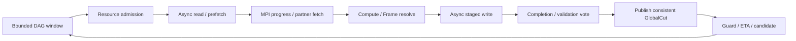

# Phase 4 設計書：非同期実行と階層スケジューラ

- 作成日：2026-10-13
- 状態：設計。以下の新規 module、API、設定値、性能目標は未実装・未測定。
- 対応仕様：[開発計画 Phase 4](../plan/distributed_quantum_circuit_simulator_development.md#phase-4非同期階層スケジューラ)、同計画 §4.3〜4.12、§8、§16.3。
- 前提：[Phase 3 実装](phase3_implementation.md)、[Phase 3 実測](phase3_benchmark.md)、[macOS/Linux I/O 資料](../ref/direct_io_linux_macos.md)。

## 1. 到達目標

同期 MPI runtime の意味・位相・Binding・所有権を維持し、bounded な I/O、通信、計算を重ねる。性能を継続観測して LIVE_TUNE を先に試し、移行費用と推定誤差を回収できる場合に safe frontier で計画を変更する。

| 要件 | 成果物・合格条件 |
|---|---|
| 非同期 I/O／MPI | request と buffer の寿命を管理する progress loop、macOS worker I/O、Linux optional io_uring |
| prefetch／background | 未実行 DAG に基づく先読み、pin・writeback・予約量の上限、foreground の starvation 防止 |
| Parameter batch | immutable prefix と Binding 別 COW、rank ごとの統合予算、共有 disk／MPI の公平な割当 |
| Runtime Guard | 条件一致、持続判定、hysteresis、alert、版付き RuntimeProfile、ETA の再予測 |
| 運用と切替 | observe／recommend／auto、手動 policy／dry-run、LIVE_TUNE→FRONTIER_REPLAN→検証 |
| S2／FusedSWAP | 証明できる DAG 順序変更、streaming 複数 bit 転置、S0/S1 と費用込み比較 |
| Gradient Scheduler | unitary adjoint、checkpoint/recompute、適用可能な parameter-shift job の I/O-aware 選択 |
| 完了 | 2/4 rank MPI＋SSD の数値一致と、性能低下注入から改善確認までの再現可能な trace |

固定 rank 数・complex128・既存 gate semantics を継続する。rank 脱落後の communicator 継続、GPU、任意の近似 commuting、実行中の Block 幅変更は対象外。大規模推定・HPC の 40/50Q dry-run を製品 CLI として整備する作業は Phase 5。

## 2. Phase 3 からの変更点

Phase 3 の 16Q／状態 1 MiB／rank RAM 256 KiB の一回の測定では、materialize は P=1 が約 7.055 秒、P=4 packed が約 11.193 秒。4 rank packed は full より send payload を 25% 減らしたが、全体時間の大きな改善は確認していない。背景負荷を隔離した scaling 実験ではなく、同期 coordinator、collective metadata lookup、SQLite／Frame 解消の改善を優先する根拠として扱う。[測定条件と結果](phase3_benchmark.md)

現在の `fetch()` は collective な metadata lookup＋source resolve＋Sendrecv を一回ずつ行い、`BlockCache.ensure()` は dirty eviction を同期書込みする。`BufferLease` の context 終了と buffer 解放を同一視できるのは、この同期実行だからである。既存関数を worker から呼ぶだけでは非同期化しない。

| module 案 | 責務 |
|---|---|
| `async_io.py`／`native/uring_backend.c` | caller-owned buffer の submit/poll、worker／io_uring、short I/O と完了通知 |
| `mpi_progress.py` | typed Isend/Irecv、bounded request slot、main-thread progress、通信完了 |
| `execution_tasks.py`／`async_scheduler.py` | lazy task/window、依存、予約、private stage、GlobalCut 公開 |
| `cache_policy.py`／`cache.py` | future-aware eviction、prefetch、I/O／MPI pin、dirty writeback |
| `runtime_guard.py`／`runtime_cost.py` | condition matching、rolling profile、health／ETA、候補の不確実性 |
| `safe_replanner.py`／`runtime_control.py` | policy epoch、dry-run、safe frontier、計画 commit／fallback |
| `s2_planner.py`／`fused_swap.py` | bounded dependency window、合法な reorder、合成 index permutation |
| `parameter_batch.py`／`gradient_scheduler.py` | Binding job admission、prefix lease、gradient 候補と job group |
| `distributed_checkpoint.py`／`lifecycle.py` | 実行 tape・plan/policy/profile 版と checkpoint extension |
| `examples/phase4*.py`／tests | correctness、fault injection、固定計画との比較、完了条件 report |

Phase 3 の同期経路を correctness reference として残す。通常の `import svsim` は MPI／native I/O を初期化しない。Python は uv、mpi4py は既存 `mpi` extra。Linux native backend は optional build とし、必須 Python dependency にしない。

## 3. 実行モデルと一致 cut

semantic IR と parameter Expr は不変。source occurrence と、実際の順序で実行する `ExecutionStep` を分ける。step は `source_ids, input_cut, output_cut, binding_id, layout_id, placement_epoch, plan_version, policy_epoch` を持ち、layout 交換は `origin=layout` と inverse permutation を記録する。

まず一つの contiguous source window を execution epoch とする。S0/S1 は元順序、S2 は窓内の合法な topological order。観測、prefix、snapshot、利用者指定 frontier、Binding-dependent suffix、layout 遷移を epoch 境界とし、指定した source frontier より先の gate を投機適用しない。

窓内の reorder や background materialization 途中の root は private。公開 `GlobalCut` は窓の全 source が完了した prefix に限る。private view の cursor は実行 step の ordinal と coverage を示し、source op_id の大小を「適用済み」判定へ使わない。窓内の task coverage は bounded metadata または disk index に保存し、公開時に全 Block の欠落／重複を検査する。Phase 3 の scalar frontier を非 prefix な途中状態に流用しない。

lazy task は `PLANNED → RESERVED → INPUT_READY → IN_FLIGHT → COMPUTED → STAGED → COMMITTED`。失敗した未公開 task は `FAILED`、安全に採用しない結果は `DISCARDED`。output は immutable COW、入力は version pin。Joint task は必要な全 partner の完成を待ち、二入力の片方だけを可視化しない。



metadata は window 単位の bounded descriptor batch で routing し、Frame asset は hash で重複排除する。全 Block list／Task DAG を RAM 展開しない。cache hit、disk completion 順、rank ごとの ready 順が異なっても、control collective の呼出し順を変えない。

## 4. progress loop と非同期 MPI

各 rank の main thread が唯一の scheduler／SQLite catalog writer／MPI caller。I/O worker は FD と buffer 上の read/write だけを行い、compute worker は借用 input/output の kernel だけを行う。completion queue から main thread が version・checksum・metadata を登録する。BLAS／worker の同時実行数を管理し、GIL のある Python scalar kernel を thread 化しただけの高速化を仮定しない。

multithreaded runtime は提供 thread level が FUNNELED 以上の場合に有効化する。main thread での MPI 初期化と transport 構築を前提とし、MPI 呼出し元が初期化 thread であることを Is_thread_main 等で検査する。単に Python main thread という理由で FUNNELED の要件を満たしたと扱わない。SINGLE の既存 communicator では worker を起動せず cooperative/synchronous mode にする。MULTIPLE は必須にしない。[MPI_Init_thread の thread level 定義](https://docs.open-mpi.org/en/main/man-openmpi/man3/MPI_Init_thread.3.html)

main loop は completion 回収→ready task 更新→MPI request progress→credit 内 submit→health/control 処理を繰り返す。計算が長い場合は block/group 単位に区切って main thread に戻るか、MPI を呼ばない compute worker に渡す。nonblocking API の発行だけで overlap が得られるとは仮定せず、progress poll 間隔と completion latency を測定する。

通信は canonical descriptor を合意後、receive buffer／Irecv を先に確保し、peer の ready/credit を受けて Isend を発行する。振幅に object MPI を使わない。request と memoryview と BufferLease を強参照し、send 完了まで input を変更せず、receive 完了・検査前に kernel に渡さない。[Open MPI Isend の buffer lifetime](https://docs.open-mpi.org/en/main/man-openmpi/man3/MPI_Isend.3.html)

`Request.Testsome/Test/Waitsome` 等で進行を確認する。request を Free しただけで buffer を解放した扱いにはしない。[mpi4py Request API](https://mpi4py.github.io/mpi4py/stable/html/reference/mpi4py.MPI.Request.html)

Phase 3 の tag=0／one outstanding round を拡張し、bounded slot と generation を使う。`run_id, binding_id, stream_id, plan_version, stage_id, task_id, slot_generation, input_versions, layout_id, placement_epoch, representation, chunk_seq, bytes` を照合する。tag は TAG_UB 以下の channel/slot を使い、slot は send／receive の両完了と acknowledgment 後に再利用。task ID をそのまま tag にしない。source/peer を固定し、古い generation の completion を新 task へ採用しない。

初期版は固定 communicator 上で data request を複数 outstanding にする。control は window ごとに固定順の descriptor、admission、completion、commit を一つずつ進める。control の非同期 collective は main loop で poll し、各 rank が同じ collective sequence に参加する。reduction の batch と Binding job の順も coordinator が決める。local completion の順で collective を発行しない。

## 5. macOS／Linux の非同期 I/O

| backend | 実行方法 | 選択と fallback |
|---|---|---|
| macOS buffered／F_NOCACHE | bounded thread pool の既存 positional read_into/write_from | Phase 4 の共通実装・Mac 開発経路 |
| Linux buffered／O_DIRECT | 同じ worker I/O | native backend 不在時の検証済み経路 |
| Linux io_uring | optional liburing adapter、read/write/fsync SQE、CQE poll | capability probe 成功時。明示要求で利用不可なら理由付き拒否 |
| cooperative | main loop 上で一つずつ synchronous I/O | MPI SINGLE／worker 不可の環境 |

I/O engine の共通契約は `submit_read/write/flush → IORequest`、`poll → Completion`、`drain`、`close`。queue の request metadata、native ring、pinned pages も管理予算へ含める。read/write backend の選択と async engine の選択を別にし、F_NOCACHE と O_DIRECT の相違を既存 capabilities に保つ。

allocator が先に segment/offset を予約し、worker は排他的な範囲へ書く。SQLite、allocator、Frame registry と journal は worker で操作しない。dirty eviction は writeback queue に移し、完了まで buffer と version を pin。catalog の extent checksum／resident release は成功完了後に行う。新 version を「disk にある」として publish する前に必要 bytes が揃っていることを検査する。

short I/O は総 byte count を管理する。buffered I/O は残りを再発行する。O_DIRECT の残り offset/length が alignment を満たさない場合は I/O error として扱い、暗黙 buffered fallback をしない。EOF／truncated extent、CQE の負値、worker exception を共通 error completion に変換する。通常 write 完了と checkpoint durability を分ける。

io_uring cancel の completion と元 request の completion を区別し、元 I/O の終端が確定するまで pin を保持する。native wrapper は capability/version、submit count、CQE result、user_data generation を保存する。初期版は SQPOLL と registered buffer/file の最適化を必須にしない。[liburing cancel 契約](https://github.com/axboe/liburing/blob/master/man/io_uring_prep_cancel.3)、[CQE 取得](https://github.com/axboe/liburing/blob/master/man/io_uring_wait_cqe.3)

## 6. RAM、cache と backpressure

rank budget を process 全体で一つにし、job ごとの quota はその予約 ledger の内訳とする。host 予算も共有 SSD／NUMA domain／MPI staging／worker stack／native ring の余裕を考慮する。caller-owned output と MPI 内部 memory／OS cache の accounting 境界は report へ明記する。

block buffer の page/alignment cost を L(B)、tile を L(T) とし、live peak を次で admission する。

`metadata + resident/cache + input/output + I/O pins + MPI pins + packing + reductions + rollback/COW + native overhead`

同じ lease を複数用途から参照する場合は byte を一回予約し、pin を別々に数える。task は実際の lifetime DAG に従って必要資源をまとめて取得し、input だけを取り置いて output 待ちする循環待ちを避ける。予約不可なら prefetch／background を減らし、foreground 最小 task と completion drain の予約を優先する。

`BufferLease` に completion-owned pin を追加し、context 終了は owner ref の解放とする。IORequest/MPIRequest/compute が残る間は backing storage を close／evict／GC しない。task 終端で全 pin が 0 になることを検査する。cache.ensure の同期 eviction は async mode では queue/credit に置換し、過剰な pinned dirty data を作らない。

future-aware cache は bounded lookahead の next-use、reuse 回数、Frame 解消費用、dirty write 費用、prefix 共有度を評価する。未知 future は従来 LRU へ戻す。優先順は foreground dependency、writeback/drain、gradient critical pair、parameter job、prefetch/background を基本とし、weighted fair queue と aging を付ける。

prefetch は immutable base extent を優先する。resolved amplitude の再利用 key は dataset/store/version、source coordinate、Frame/log/phase、layout、依存 parameter の値と exact witness を含む。Binding 間で同じ key と証明できない logical buffer は共有しない。不要 prefetch は発行前に取り消し、発行済み read は完了を待って結果を捨てる。

## 7. Parameter batch と prefix

最初は同じ n/b/P／semantic source の Binding job を、同じ rank group の scheduler が交互に進める。job ごとの main-loop 呼出しを独立 Python thread に任せない。`BatchJob` は job/run/binding ID、quota、private root、source frontier、plan/profile/policy 版、prefix lease、結果宛先を持つ。複数 rank group の並列は、communicator と catalog path が分離できる次の実装段階に限定する。

prefix は Phase 3 の durable immutable snapshot を利用し、固定 parameter／exact witness、initial state、source、frontier、layout／placement を検証する。read-only 元 extent と各 job の COW 出力を分ける。prefix の reader は共有 budget を使い、既存 `fork()` の simulator ごとの独立 budget をそのまま batch の総予算として合算しない。

batch の active job 数は最小 foreground working-set＋prefix/cache＋adjoint streams＋COW/SSD headroom で admission する。共通 prefix read を coalesce しても全 job の logical result が共有可能とは限らない。checkpoint/writeback／prefix read の混合負荷を device queue で制御し、writer saturation が reader を止めない配分にする。

pending job は Binding を差し替え可能、実行開始後は不変。一 job の失敗は、既に posted な通信を drain して全 rank が同じ終端を確認してから batch から外す。失敗 job の control/collective slot はその window 終端まで維持し、rank-local な判断で reduction 順序を詰めない。共有 communicator の rank そのものが失われた場合は batch 全体を停止・checkpoint restart とする。

## 8. S2：依存を守る reorder

source IR から bounded な dependency window を作る。qubit support の交差する gate 間には元順序の edge を残す。初期版の reorder 証明は disjoint support と、bit-order／control／位相まで検証した diagonal commuting に限定する。任意 Dense／条件付き gate の行列が「近い」ことを commuting の証明にしない。

prefix／observable／snapshot／gradient method 切替／明示 frontier は hard barrier。layout transition には wire mapping を変える versioned dependency を置く。metadata-only permutation／Frame rule も semantic operation であり、対象 qubit と predicate の依存を持つ。未知な依存や shared log cursor を安全に分離できない場合は元順序に戻す。

候補探索は window_size=32、beam_width=4、最大 2 bit-pair の fused 候補を初期設定案とし、CPU／metadata 上限を設ける。値は校正対象。S0、S1、S2 候補を同じ cost model に通し、S2 の探索・追加 COW と layout 復元を含めて改善の下界を比較する。無益なら S0/S1 を保持する。

actual execution tape は reordered source occurrence と derived step の対応を固定し、plan hash に含める。fusion が source をまとめる場合も Expr derivative と generator mapping を残す。随伴は source index の逆順ではなく、この actual tape の逆順を用いる。

## 9. FUSED_INDEX_BIT_SWAP

複数の physical swap を ordered pair list から一つの index permutation pi に合成し、`i_out=pi(i_in)` で配列を再配置する。logical SWAP と区別する。disjoint pair の初期 fast path と、同じ bit が重なる一般 composition の双方について逐次 SWAP oracle を用意し、適用順と inverse を定義する。

任意 Frame/log/phase を旧 layout で解消し、bounded destination group／tile の gather/scatter と typed MPI を使う。destination Block を組み立てる incoming fragment の coverage を disk/bounded index へ保存し、穴／重複を検査する。placement indirection／foreign prefix の実 extent owner を参照し、rank xor だけで routing を決めない。

group の全 output working-set が予算に収まれば full Block を一度組み立てる。収まらない場合は aligned destination tile を一意な範囲へ書く検証済み経路を使う。O_DIRECT の alignment や Frame 解消に必要な full Block を tile サイズで過小評価しない。合法な streaming route がなく、COW 容量も確保できない候補は admission 前に除外する。

新 root、layout、placement、inverse transition、plan version を一つの transition として公開する。swap の途中 state を snapshot／observable へ見せない。fused により state 全体の pass 数が減るかを測り、MPI byte 削減だけで採用しない。

## 10. 校正、Runtime Guard と ETA

Stage 1 の HardwareProfile／PlanTemplate は不変。既存 ObservePerformanceGuard の matched-condition／連続窓／RuntimeProfile を拡張し、device／rank／peer／job 別の成功 completion から観測する。

condition は実 backend、device/host pair、packet/block/tile bytes、direction、I/O depth、同時 read/write/MPI、job 数、Frame representation、NUMA domain、MPI/library version、flush、warmup を含む。Phase 3 の一回ずつの transfer profile を多 outstanding・mixed I/O の基準に転用しない。未知条件は INSUFFICIENT_BASELINE／PROFILE_MISMATCH とし、欠測を劣化や成功として数えない。

計測は queue wait、submit-to-completion、kernel、Frame resolve、packing、progress wait、fsync と wall を分ける。send payload の全 rank 合計を amplitude MPI とし、recv を二重加算しない。重なった I/O/MPI/CPU 時間を合計して wall とみなさない。rank local clock の同期を仮定せず、epoch elapsed MAX と peer/rank distribution を集約する。

health は `HEALTHY → SUSPECT → DEGRADED → TUNING/REPLAN_PENDING → VERIFYING → HEALTHY/DEGRADED`。不足データ、metric mismatch、I/O error を別状態として保存する。初期閾値案は既存と同じ bandwidth/latency 比 0.8、recovery 0.9、8 successful samples×3 non-overlapping windows。最低 bytes／最大 window age、p95 latency、cooldown 120 秒、最大 3 frontier replans/時も設定可能にする。すべて PoC で校正する。

RuntimeProfile は version と sample age／coverage／uncertainty を持つ immutable snapshot。同条件の rolling median と tail latency を使い、Stage 1 基準との劣化判定と、最新環境での残時間推定を分ける。新たな低性能を基準にして自動的に HEALTHY 扱いしない。

ETA は残り lazy DAG の critical path と device/peer ごとの resource demand を同時に評価する。未検証 overlap は加速として見込まず、mixed calibration に一致する場合だけ重なりを推定する。sample の無い候補は不確実性を広げ、auto 採用しない。monitor CPU/time と log bytes に上限を置き、詳細 trace を間引いても fault／transition record は残す。

## 11. LIVE_TUNE と safe frontier の commit

| 分類 | 変更 | 境界 |
|---|---|---|
| LIVE_TUNE | prefetch／I/O depth／active job 数／未着手 task の priority／許可済み replica source／通信 credit | task 発行境界。posted request の buffer/count/tag は不変 |
| FRONTIER_REPLAN | S0/S1/S2、layout／fused swap、Frame group／Joint group、placement、gradient schedule | private epoch を drain した一致 prefix cut |
| RESTART_REQUIRED | rank 数／communicator 再編、Block 幅／format、失われた rank store の置換 | durable checkpoint と offline migration／再投入 |

MPI chunk や route の LIVE_TUNE は新しい transfer round の peer 合意後に発行する。in-flight の packed/full を途中変更しない。並列度を減らす場合は既存 request を drain してから低い credit 上限を適用する。資源を増やす変更は新しい全参加 rank admission を要する。

DEGRADED になったらまず該当 critical path の低リスク LIVE_TUNE を、一回につき変更項目を制限して評価する。条件を変更した比較には対応 baseline を使う。改善しない、候補が無い、または残時間が短い場合は静的計画継続＋alert。高額な layout 移行を先に行わない。

候補の利益下界を次で判定する。

`gain_lower = continue_time_lower - (candidate_time_upper + planning + drain + migration + validation + sync + checkpoint)`

候補は RAM／SSD／pin／Frame／version／DAG／合成誤差制約を満たし、gain_lower が 0 と最低改善率（案：残時間の 10%）を超える場合だけ採用する。探索、monitor、移行に使った時間も outcome の end-to-end 評価へ含める。

safe frontier は source prefix、全 Block の実行 step coverage、Binding/witness、root、layout/placement が一致し、対象 root／slot に未完了 I/O／MPI／compute がなく、reduction と journal registration も完了した点。async request が参照する input/output root と lease は cache／GC の生存参照閉包へ含める。tape、journal、layout、Binding と reduction cursor を同じ cut に固定する。初期実装は全 rank の epoch 境界で合意する。計測のために毎 gate barrier を追加しない。局所 subset commit は catalog／ownership 依存閉包の証明ができた後の最適化とする。

commit は `propose/dry-run → stop affected admission → drain → reserve/vote → stage migration → validate/vote → durable plan+cut commit → activate`。rank ごとの prepare に旧/new root、candidate/plan/policy/profile hash、layout/inverse、tape cursor を含め、global manifest の atomic replace／directory fsync を唯一の durable commit point にする。

global commit 前の失敗は staged root を採用せず旧 cut/plan から継続する。commit 後に通知／verification が失敗しても、新 manifest を authoritative とし旧 plan の計算済み gate を再適用しない。悪化した場合は新 cut から前進する別候補を作るか、明示した durable checkpoint から再開する。

## 12. 運用 API と checkpoint 互換

observe は monitor/ETA/候補提示のみ。recommend は dry-run 結果を保存し、利用者が candidate ID を指定して適用する。auto は許可された LIVE_TUNE と利益下界の確認済み frontier candidate を適用する。policy と mode の変更を coordinator の control queue へ渡し、全 rank に policy_epoch と適用境界を配送する。worker callback 内で直接変更しない。

`dry_run` は候補探索と metadata validation のみで、振幅 migration、gate 実行、fsync checkpoint、active plan 変更を行わない。candidate には source plan version／cut／policy hash と有効期限を持たせ、古い提案は適用前に再評価する。operator API は source circuit、実行中 Binding、完了 task を変更しない。

Phase 4 checkpoint を schema/semantics v4 とし、v3 の field に ExecutionStep tape／epoch coverage、plan snapshot、policy/profile version、runtime state を追加する。未完了 request や FD／worker は永続化せず drain 後の cut だけ保存する。stage directory／prepare のみの candidate は recovery で無視する。

v3 distributed checkpoint は P/n/b を一致させて読み、保存された gate/layout history から actual tape を構築し、root／Binding／現在の layout を保持した v4 state に変換する。未実行 suffix は S0/synchronous policy で開始する。v1/v2 は Phase 3 の P=1 migration adapter を経由する。v4 を Phase 3 reader が誤読しないよう schema を明示拒否する。再開時に host/backend/MPI 条件が変わった profile は無効化し、再校正まで保守的経路を使う。

```python
# 未実装 API 案。全 rank は collective entry を同じ順で呼ぶ。
policy = AsyncPolicy(mode='observe', io_engine='auto',
    max_io_requests=2, max_mpi_requests=4, prefetch_blocks=2,
    lookahead_gates=32, swap_policy='S2')
with AsyncDistributedSimulator(n, config, comm=MPI.COMM_WORLD,
                               policy=policy) as sim:
    # gate/bind/expectation/gradient の semantics は Phase 3 を継承。
    sim.materialize(binding=binding)
    impact = sim.runtime.request_replan(apply=False)
    sim.runtime.apply_candidate(impact.candidate_id)
    sim.runtime.set_mode('auto')
    snapshot = sim.commit_snapshot()

with ParameterBatchExecutor(template, prefix, rank_budget=config,
                            policy=policy) as batch:
    result = batch.run(bindings, observable=observable, gradient='auto')
```

`io_engine='auto'` は capability probe 後の選択を trace に保存する。明示 io_uring 要求の silent fallback はしない。API 名と既存 simulator の adapter 境界は実装時に確定する。

## 13. I/O-aware Gradient Scheduler

既存 unitary adjoint を最初の候補とし、forward/adjoint の二つの stream と observable workspace、immutable final/prefix を同じ resource ledger で予約する。partner fetch と inner kernel は Phase 3 と共有し、pair の prefetch／取得順だけを合法な reduction ordering の範囲で変える。全状態 Gather／全中間状態 RAM 保持をしない。

checkpoint/recompute 候補は bounded source checkpoints を保存し、必要 segment を同じ Binding/witness と actual layout/tape から再計算する。新しい checkpoint の書込み、保存容量、fsync、restore、再演算と混合 I/O 費用を含める。一般最適な Revolve 実装を必須にせず、検証済みの一定間隔／有限候補から始める。

parameter-shift は generator spectrum と shift rule を証明できる source occurrence に限定する。shared parameter を回路全体で一律ずらす規則を仮定しない。occurrence ごとの合法な shift と元 Expr derivative を chain rule で合算し、controlled generator には証明された一般化 rule を使う。未対応 generator は adjoint へ戻す。finite difference は検証 oracle とし、auto の精度同等な候補には含めない。

method/schedule は parameter job 開始時か完了 segment の safe frontier で選ぶ。途中結果の provenance（observable/source occurrence/Binding/method/step）を記録し、再計画時に重複勾配を加算しない。adjoint tape の逆順と S2/fused layout inverse を保持する。各候補の総時間には全 shift job、prefix 再利用、2 stream I/O、checkpoint/recompute、gradient vector reduction を含める。

## 14. 異常、cancel と shutdown

通常 I/O／checksum／kernel failure は main loop へ error event を送る。新しい affected task の admission を止め、posted peer receive を放置しない error/terminal protocol を進め、既存通信の完了／drain 後に vote する。rank-local 例外で片方だけが collective を飛ばさない。

全 rank は window 合意済み outstanding ledger を保持し、異常時も progress loop を継続する。peer が未完了 traffic を持つ間に別 sequence の vote／collective へ入らない。予約済み receive に対して source が payload を未送信のまま通常失敗した場合は、同じ source/tag/slot に zero-length error payload と control TERMINAL record を送り、receiver は status count と terminal reason を照合して結果を discard する。既に posted な本来の send は置換せず完了を待つ。chunk ごとの予約・完了・terminal acknowledgment まで ledger で追跡し、正常な amplitude/health sample には数えない。

発行前 cancel は予約を戻す。発行済み I/O/MPI は Cancel が成功したと仮定せず、元 request の終端と matching peer の結果を確認してから buffer を解放する。close は admission stop→compute/I/O/MPI drain→catalog registration→lease release→FD／communicator close。duplicated communicator の解放は全 rank が同じ順で行う。library は MPI.Finalize を呼ばない。

MPI process loss、communication error 後の継続が保証されない状態、drain timeout は安全な job 停止と durable checkpoint restart にする。ERRORS_RETURN を communicator recovery と扱わない。[Open MPI の error semantics](https://docs.open-mpi.org/en/main/man-openmpi/man3/MPI_Isend.3.html)

## 15. 実装順と完了条件

| 段階 | 実装 | 必須検証 |
|---|---|---|
| 4A | request/lease ledger、fake completion engine、worker I/O | arbitrary completion order、short I/O、pin/FD lifetime、予算・backpressure、SINGLE fallback |
| 4B | main-thread nonblocking MPI、batched metadata、async epoch | P=1/2/4、複数 slot、rendezvous-sized payload、stale generation、peer failure protocol、Phase 3 と一致 |
| 4C | prefetch/writeback、parameter batch、prefix | Binding/witness 分離、共通 read、quota 公平性、reader/writer 競合、job failure、GC lease |
| 4D | mixed calibration、Guard/ETA、LIVE_TUNE | SSD／MPI／CPU を別々に低下、条件不一致、連続窓・復旧・cooldown、mode と control log |
| 4E | safe replan、S2／fused transpose、v4 checkpoint | DAG 証明、global commit 前後 fault、cost 込み採否、inverse/layout、v3 migration |
| 4F | gradient schedule、最終比較 | shared Expr／controlled Pauli／exact witness、checkpoint/recompute、合法 shift、fault/replan 後の gradient |
| Linux 専用 | optional io_uring adapter | worker と同じ結果、CQE error/cancel、buffer/alignment、fsync、未対応 capability の明示拒否 |

すべての数値試験は global phase を合わせず complex128 を照合する。state／expectation 許容誤差は 1e-10、analytic gradient は 1e-9、central difference は step sweep を行い 1e-6 を目安とする。非同期 reduction の順序差と誤差を report する。

追加 regression は conditional `(HS)^3`、未消化 T/Pauli log、ExactPi と近い float、virtual permutation 後の Operation/Frame shipping、open control MCX packed/full、Dense group admission、全 bit 階層と overlapping fused pair、observable Y/upper-X/Z、adjoint reverse workspace を含む。同期 Phase 3 tests は維持する。

fault injection は reserve/read/write/fsync/Isend completion/kernel/prepare/global commit/通知の各点を対象にし、epoch の old cut か authoritative new cut のどちらが再開対象かを明示する。fake scheduler の exhaustive completion permutations と real MPI launcher timeout の両方を使う。macOS 上の mock io_uring を Linux native 実測として報告しない。

最終比較は同じ source/initial/Binding、n/b/P、managed budget、backend、数値精度で行う。state が rank budget を超える MPI＋SSD を含め、S0/S1/S2、sequential/fused、synchronous/async、fixed/observe/LIVE_TUNE/replan、batch／gradient 候補を比較する。warmup と反復回数を決め、median/tail と run variation を保存する。

必須の適応シナリオは、固定計画・同じ劣化時刻／量を持つ対照から、SSD/MPI の持続低下→Guard 検出→LIVE_TUNE→必要なら frontier replan→新条件での VERIFYING を追跡する。減速しても利益下界がないケース、短い残回路、未知 baseline、復旧・再悪化では無益な切替を抑える。改善を再現できる positive case と、変更を拒否する negative case の双方を合格条件にする。

report は compile/metadata/planning、queue/progress、Frame、packing、MPI payload、SSD read/write/fsync、swap passes、COW live peak、pin/RAM peak、checkpoint/restore、期待値／勾配、monitor／migration と end-to-end を分ける。検出遅延、誤検出、切替回数、ETA 誤差、予測利益と実利益も保存する。計測・探索・移行込みで改善しない条件も残し、同一 Mac の結果から multi-node scaling を推測しない。

この設計段階では native dependency 導入、runtime API の実装、MPI/性能実験は行わない。
