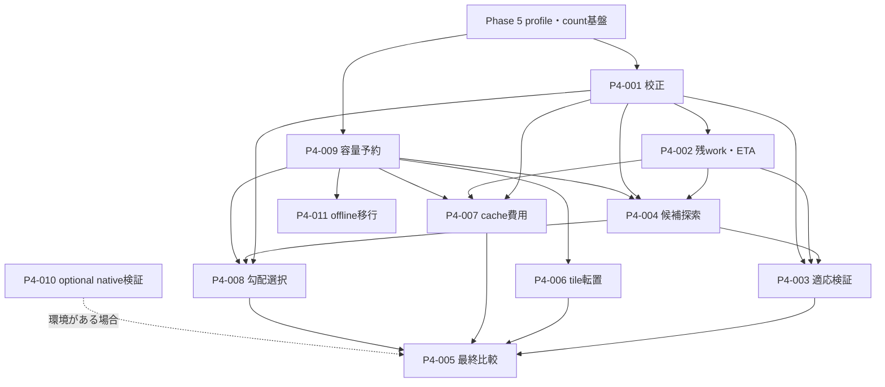

# Phase 4 残件の全体設計

作成日：2026-10-13。状態：設計。コード確認の基準は`6aa8581`（Phase 5の計測・静的推定基盤）。本改訂では実装、計測、クラスタ接続、job投入を行わない。[Phase 4設計](phase4_design.md)、[backlog](phase4_backlog.md)、[Phase 5実装](phase5_implementation.md)を前提に、残件の実装契約と受入条件を具体化する。

## 1. 設計書の分け方

2026-10-14更新：[P4-009／001の基盤実装](phase4_foundation_implementation.md)を追加した。個別backlogはIN_PROGRESS。下記M1〜M5の受入条件は維持する。

同日更新：[writer予約・永続化境界](phase4_writer_durability_implementation.md)を補強した。sidecarの予約保持／process crash、trace admission、SQLite build／dispatch identityを追加したが、全writerのcut結合と回収、host調停は残り、M1の受入条件を維持する。

同日更新：[P4-002／004／006／007の先行実装](phase4_remaining_implementation.md)を追加した。finite capture／候補、P=1 tile、cache identity／費用fallbackをMacで検証した。細粒度profile、自動切替、P>1 tile、共有／公平性と実性能は残り、M2／M3の完了は宣言しない。

同日更新：[P4-003／005／008の先行実装](phase4_validation_implementation.md)を追加した。evaluation専用注入と観測／拒否、paired report、明示勾配校正をMacへ接続した。M4／M5に必要なpositiveな実利益と最終matrixは未達で、各項目はIN_PROGRESSとする。

backlog IDごとに設計書を作り、各項目を個別に実装・review・検証できるようにする。依存関係、データ形式、資源上限、MPI合意、commitと運用境界は本書で共有する。個別書は現状との差、入出力、アルゴリズム、失敗時の処理、受入条件を定義する。共通契約の変更を伴う場合は本書と関係する個別書を同じ変更で改訂する。

設計作成と実装完了は別に管理する。設計書の作成だけではbacklogの状態を変えず、実装着手・検証の進捗をbacklogへ反映する。各設計は以下の成果物で対応づける。

| ID | 個別設計 | 最初に実装する単位 |
|---|---|---|
| P4-009 | [disk・SQLite予約](phase4_tasks/P4-009_disk_admission.md) | writer棚卸し、token ledger、catalog transaction envelope |
| P4-001 | [校正・runtime計測](phase4_tasks/P4-001_measurement.md) | completion event、profile adapter、有限校正 |
| P4-002 | [残workとETA](phase4_tasks/P4-002_remaining_eta.md) | safe-cut snapshot、有限window＋counted suffix |
| P4-004 | [候補探索・切替](phase4_tasks/P4-004_replanning.md) | capability registry、identity候補、LIVE_TUNE比較 |
| P4-006 | [aligned tile転置](phase4_tasks/P4-006_tile_transpose.md) | identity Frameのdestination tile writer |
| P4-007 | [cache費用](phase4_tasks/P4-007_cache_policy.md) | cache identity、next-use費用、LRU fallback |
| P4-008 | [勾配方式の校正・選択](phase4_tasks/P4-008_gradient_selection.md) | method applicability、whole-method実測、admission |
| P4-003 | [適応シナリオ](phase4_tasks/P4-003_adaptive_validation.md) | deterministic injection、fixed/auto paired実行 |
| P4-005 | [最終比較・report](phase4_tasks/P4-005_performance_evaluation.md) | case manifest、raw/report、必須比較matrix |
| P4-010 | [native io_uring検証](phase4_tasks/P4-010_native_uring.md) | Linux capability判定とworker対照試験 |
| P4-011 | [offline v3移行](phase4_tasks/P4-011_offline_migration.md) | source closure inventory、owner別copy、v4 commit |

## 2. 依存と実装順

P4-009とP4-001を先行する。P4-001の小規模計測は現行の有限予算でも開発できるが、容量保証は未達と表示する。P4-002後にP4-004のfull-block合法候補を作り、P4-006未実装時はtile候補を拒否する。P4-007/008の初期契約は先に実装可能で、自動運用・性能判定を共通costへ接続してから完了する。

| milestone | 成果物 | 次段階へ進む条件 |
|---|---|---|
| M1 | 009＋001 | 全writerの事前予約、raw completion、条件一致、不足の明示 |
| M2 | 002＋004のfull-block候補 | 自動ETA、全rank同じ候補、unknown/stale候補の拒否、safe commit |
| M3 | 006＋007＋008 | tile route、cache/gradientの合法性・容量・数値検証 |
| M4 | 003＋005 | positive/negative、held-out ETA、費用込み改善、全必須比較 |
| M5 | 011、環境に応じ010 | offline移行の範囲解決、native証跡またはoptional unavailable |

P4-010は環境依存のoptional。P4-011はコピー先やsource closureの安全性が解決するまで必須範囲の残件。順序は全項目を直列化する指定ではなく、統合検証が必要になる依存を表す。

## 3. 共通データ契約

以下の型は新規実装案。既存`CostSample`、`CostTask`、`ReplanEvidence`、`MethodCost`の手動APIは維持し、自動生成に新adapterを追加する。

| 型 | 主な内容 | 所有者 |
|---|---|---|
| `ExecutionContext` | run/job/source/initial/binding/witness/observable、n/b/P、host配置、build、backend、layout、Frame、plan/policy/profile版 | runtime main thread |
| `CompletionObservation` | event/parent ID、condition全体とkey、operation/units/count、queue/service/protocol wall、CPU、bytes、success、scope | P4-001 |
| `ProfileSet` | host/device/peerごとの不変profile IDとcondition registry、採用可能scope、品質、raw参照 | P4-001 |
| `RemainingWork` | source occurrenceとactual step、window DAG、counted suffix、in-flight ledger、barrier、unknown | P4-002 |
| `CostEnvelope` | lower/expected/conditional upper、単位、根拠・有効範囲、coverage、model version | 001/002 |
| `CandidatePlan` | source context hash、合法性証明、資源、移行・校正・commit費用、予測gain、期限 | P4-004 |
| `DiskReservation` | host/volume/dataset/job、owner generation、operation上限、物理化済み量、終端・回収根拠 | P4-009 |
| `EvaluationCase` | 対照の同一性、injection schedule、測定区間、環境、acceptance、raw/report ID | 003/005 |

JSONは既存Phase 5のbounded codecを共有する。bytes・大きなcountはdecimal string、unknownはnull＋reason、非有限数・bool count・duplicate keyを拒否する。新しいkindは専用validatorを追加し、現在のhardware-profileへ未知top-levelを混ぜない。schema_version=1でもkind/record版を明示し、旧readerが理解しない必須契約は拒否させる。

hardware/profile文書、raw run、semantic workloadは不変。観測のrolling sequence、cost model version、guard状態は別オブジェクトとし、既存`profile_version`一つに別の版を上書きしない。configuration fingerprintと全conditionを比較する。gateの意味を変えるBinding/exact witnessと、性能条件としてのBinding classも区別する。

## 4. Costと残workの契約

単独kernelの中に含まれるメモリアクセスをRAM費用で再加算しない。MPI whole-transferに含まれるcontrol/ackを再加算しない。mixed groupは構成taskを消費済みにして一回だけ数える。network workはsend payloadを一回数え、recvは診断値。rank並列のwallはMAXを用い、rank wallのSUMはCPU/resource work用と明示する。

costの単位を`seconds/call`、`seconds/group`、`bytes/s`等で固定し、quantityとの対応を検証する。既存RuntimeCostModelの秒単位resource lowerには新たな帯域除算を加えない。Phase 5のeager全state passは保守的static referenceであり、runtime remaining DAGへそのまま複写しない。Frame保持、virtual permutation、fusion、cache hit、actual layout/historyをruntime adapterで数える。

baseline／observed／adaptedは同じremaining snapshotに対する別cost view。未校正のcritical成分がある総ETAはnull。件数、payload、kernel work、critical chainのcoverageを分ける。sample min/max、bootstrapのmean interval、未来のruntime envelopeを区別し、95%や厳密boundをraw extremaから作らない。

自動候補は、採用可能な実測scope、十分な試行、現conditionとの一致、covered resource、残workの対応、切替費用の条件付き上界が必要。費用のいずれかがunknownなら推薦内容を残して採用しない。利益式は

`gain_lower = continue_lower - (candidate_execution_upper + planning + drain + migration + calibration + validation + commit + expected_cleanup)`

とし、各項を一回だけ数える。既存ReplanEvidenceに自動変換する際は、足りない項を黙ってゼロにせず新evidence版で保持する。epoch内の通常commit費用と追加checkpoint費用も分ける。

## 5. MPI・切替・永続化

全MPIとSQLite mutationはmain thread。worker/native callbackはlocal event enqueueまでとし、新しいcollectiveを完了順に起動しない。event summaryの交換は合意済みwindow境界で行い、payload/control/health用sequenceを保持する。host間のmonotonic timestampを引き算せずlocal durationを比較する。

候補同一性はrootだけでなくsource/binding/witness、frontier、layout、placement、plan/policy、採用profile set、capability snapshotを含む。TTLとcooldownの判定はcoordinatorがduration基準で合意し、各hostの絶対時計差に依存させない。候補有効期間中でもcutが進めば再評価する。

変更はsafe published cut→admission停止→posted request/terminal protocol drain→資源予約→private change→全rank検証→durable decision→decision配送/ack→公開の順。authoritative COMMIT前の失敗は旧cut、後の失敗は新cutを保持して停止・再開する。private rootを捨てる処理がCOMMIT後の状態まで巻き戻さないことをfault testする。

`observe`は計測・推定、`recommend`は候補保存、`auto`は全条件を満たす候補適用。手動明示変更と未知baselineでの自動性能変更を区別する。容量不足時のadmission/prefetch抑制はsafety throttleで、性能利益を立証したLIVE_TUNEと別reasonを記録する。mode/dry-run変更に探索の副作用を混ぜない。

## 6. Bounded運用の初期値

| 対象 | 初期上限・規則 |
|---|---|
| source window | 32 gate、beam既定4／最大16、fused pair≤2 |
| 候補 | identity込み16、探索working metadata≤64 MiB、探索wall≤min(1秒, continue lowerの1%)。lower unknown時は探索推薦まで |
| condition/raw | active condition≤256、conditionごとのrolling observation≤64、rawはdiskへbounded chunk |
| ETA | window≤32、tail group≤256、in-flightは既存request上限、budget不足はPARTIAL_ANALYSIS |
| request/job | 既存AsyncPolicyのI/O/MPI≤64、active job≤16、実quotaでさらに制限 |
| trigger | epoch境界、candidate TTL既定120秒、cooldown既定120秒、頻度設定をprofileに保存 |
| 校正 | warmup≥1、measured≥5を通常値。pilot/monitorのwall・RAM・disk別budgetを必須にする |
| 評価 | warmup2、paired measured7を初期値。重いcaseで減らす場合はlow-qualityとして自動gain証跡に使わない |

上限は設定案であり性能を保証しない。metadataの実予約、超過理由、打切り箇所をreportする。無制限のBlock列挙・peer pair列挙・future occurrence展開は行わない。途中で打ち切った結果をcompleteなcostやcapacityとして使わない。

## 7. 検証・開発環境

Mac＋uv＋local runnerを主環境とし、fake completion→実MPI P=1/2/4→buffered/F_NOCACHEの順で進める。protocol、cut、scope、budgetを検証してからLinux/O_DIRECTと実別hostへ進む。各新規クラスタ利用はjob・配布物・scratch・cleanup・資源・wallを具体化して利用許可を確認する。過去の小規模許可を拡大許可として扱わない。PBS adapterはscript render、投入は承認後の別操作。

振幅・catalog・journal・code/uv環境・詳細rawはnode-local。他ownerのデータ・管理情報・leaseはMPIで取得する。共有diskの小さな補助mirrorは[内部計画](internal/lab_cluster_execution_plan.md)の条件だけで使用し、通常経路の必須条件にしない。site情報・queue・host/pathは個別公開設計へ転記せず内部資料へ置く。

state/expectationはglobal phaseを合わせず1e-10、analytic gradientは1e-9、central differenceはstep sweep付き1e-6を既存基準とする。時間はmatched held-out ETA median相対誤差30%を初期評価目標とし、最終短区間は絶対誤差も示す。許容を超えたcase、改善なし、unknown、resource拒否をreportから除かない。

## 8. 完了の定義

各IDは個別書の受入matrixと証跡が揃ってからDONEにする。P4-001〜009、P4-011の範囲解決、010の成功またはoptional環境制約、Macと許可後の実別hostの必須検証、positive/negativeの正味利益がPhase 4完了条件。設計・mock・手動costの成功・Phase 5のstatic referenceだけでは完了しない。

固定rank数、固定Block幅、complex128、既存semantic IRを維持する。node/disk loss継続、rank再配置・複製、一般的な近似合成、QPE測定/復旧、大規模32〜36Q実測はこの残件設計のscope外。
